# BÁO CÁO TỔNG KẾT DỰ ÁN

### HỆ THỐNG QUẢN LÝ & CHĂM SÓC THÚ CƯNG (PETCARE HUB)
### KẾT HỢP QUY TRÌNH CI/CD TỰ ĐỘNG & GIÁM SÁT HỆ THỐNG

> **Người thực hiện: Nhóm phát triển  |  Thời gian hoàn thành: Tháng 11/2026**

> **Kho mã nguồn GitHub: https://github.com/Hoc123421/pet-management-system**

> **Công nghệ cốt lõi: ASP.NET Core 8.0 • Entity Framework Core • SQL Server 2022 • Docker Compose • Jenkins • SonarQube • Prometheus • Grafana**

### MỤC LỤC BÁO CÁO

- Chương 1: Tổng quan về dự án Hệ thống Quản lý Thú cưng
- Chương 2: Phân tích và Thiết kế hệ thống (Use Case, Activity, Sequence, State Machine)
- Chương 3: Kiến trúc hệ thống và Công nghệ sử dụng
- Chương 4: Thiết kế cấu trúc Cơ sở dữ liệu (Database Schema)
- Chương 5: Chi tiết các Module chức năng & Hệ thống RESTful API
- Chương 6: Đóng gói Docker & Triển khai hệ thống CI/CD tự động (Jenkins, SonarQube, SSH Deploy)
- Chương 7: Triển khai và Giám sát hệ thống thời gian thực với Prometheus & Grafana
- Chương 8: Tổng kết, Đánh giá kết quả đạt được và Hướng phát triển

---

## CHƯƠNG 1: TỔNG QUAN VỀ DỰ ÁN

### 1.1. Giới thiệu đề tài

Hệ thống Quản lý và Chăm sóc Thú cưng (PetCare Hub - Pet Management System) là nền tảng ứng dụng web toàn diện được xây dựng nhằm số hóa và tự động hóa các quy trình nghiệp vụ tại các trung tâm chăm sóc thú cưng, phòng khám thú y, spa grooming và cửa hàng phụ kiện chó mèo (Pet Shop). Hệ thống hợp nhất trên một giao diện duy nhất các tác vụ từ quản lý hồ sơ thú cưng, theo dõi tình trạng sức khỏe, đặt lịch hẹn dịch vụ trực tuyến, kinh doanh thức ăn - phụ kiện có kiểm soát tồn kho, đến bảng điều khiển thống kê doanh thu dành cho quản trị viên.

Bên cạnh việc hoàn thiện đầy đủ các phân hệ nghiệp vụ phần mềm trên nền tảng ASP.NET Core 8.0 và cơ sở dữ liệu Microsoft SQL Server 2022, dự án còn được tích hợp quy trình DevOps khép kín: tự động hóa kiểm thử đơn vị (xUnit), phân tích chất lượng mã nguồn tĩnh (SonarQube), đóng gói đa tầng (Docker & Docker Compose), triển khai tự động qua hai luồng Pipeline (Jenkins Local & Remote SSH Deployment) và giám sát sức khỏe - hiệu năng thời gian thực bằng bộ công cụ Prometheus kết hợp Grafana.

### 1.2. Mục tiêu dự án

Dự án được thiết kế và triển khai hướng tới hai nhóm mục tiêu trọng tâm về nghiệp vụ phần mềm và hạ tầng kỹ thuật DevOps:

- Mục tiêu nghiệp vụ 1 - Quản lý hồ sơ khách hàng & thú cưng: Cho phép chủ nuôi và quản trị viên lưu trữ, tra cứu, lọc, thêm mới, chỉnh sửa và xóa (đơn lẻ hoặc xóa nhanh hàng loạt các hồ sơ mới nhập) thông tin chi tiết của từng thú cưng (tên, loài, giống, tuổi, cân nặng, giới tính, hình ảnh và ghi chú sức khỏe/tiêm phòng).
- Mục tiêu nghiệp vụ 2 - Quản lý dịch vụ & đặt lịch hẹn trực tuyến: Số hóa danh mục dịch vụ (Spa & Grooming, Khám sức khỏe, Khách sạn thú cưng) và quy trình đặt lịch hẹn của khách hàng theo vòng đời trạng thái chặt chẽ (Pending -> Confirmed -> Completed / Cancelled).
- Mục tiêu nghiệp vụ 3 - Quản lý cửa hàng Pet Shop & kiểm soát tồn kho: Cung cấp danh mục sản phẩm (Thức ăn, Đồ chơi, Phụ kiện, Sức khỏe), giỏ hàng lưu trữ theo từng tài khoản và API thanh toán tự động kiểm tra, khấu trừ số lượng tồn kho thực tế trong cơ sở dữ liệu.
- Mục tiêu nghiệp vụ 4 - Xác thực đa phương thức & phân quyền rõ ràng: Hỗ trợ đăng ký/đăng nhập truyền thống kết hợp Google OAuth 2.0, cơ chế tự động đồng bộ phiên người dùng (Session Sync) và phân quyền giữa Khách hàng (Customer) với Quản trị viên (Admin).
- Mục tiêu kỹ thuật DevOps - Chuẩn hóa CI/CD & Giám sát vận hành: Tự động hóa toàn bộ quy trình từ khi đẩy code lên GitHub đến khi kiểm thử, quét SonarQube Quality Gate, đóng gói Docker Image, triển khai qua SSH lên máy chủ và theo dõi chỉ số CPU, RAM, lưu lượng HTTP Request, độ trễ P95 trên Grafana.

### 1.3. Phạm vi ứng dụng và Đối tượng sử dụng

Hệ thống phục vụ trực tiếp cho ba nhóm tác nhân (Actor) trong quy trình vận hành thực tế tại cơ sở chăm sóc thú cưng:

- Khách vãng lai (Guest): Truy cập trang chủ, tham khảo bảng giá các gói dịch vụ Spa/Khám bệnh, tìm kiếm và lọc sản phẩm trong cửa hàng theo danh mục, gửi biểu mẫu liên hệ tư vấn và thực hiện đăng ký/đăng nhập tài khoản.
- Khách hàng / Chủ thú cưng (Customer): Quản lý danh sách thú cưng thuộc sở hữu cá nhân, đặt lịch hẹn dịch vụ chỉ cho các thú cưng của mình, theo dõi lịch sử hoặc hủy lịch hẹn khi chưa thực hiện, mua sắm sản phẩm và đặt hàng thanh toán (COD hoặc Chuyển khoản).
- Quản trị viên (Admin): Truy cập Bảng Quản Trị Hệ Thống (Admin Console) để theo dõi tổng số thú cưng, tổng lịch hẹn, số lịch chờ duyệt, tổng doanh thu hợp nhất (dịch vụ + bán hàng), đồng thời thực hiện toàn quyền CRUD đối với toàn bộ Thú cưng, Lịch hẹn, Dịch vụ và Sản phẩm.

### 1.4. Đánh giá hiện trạng và Bài toán đặt ra

Trước khi áp dụng hệ thống phần mềm tập trung và quy trình CI/CD, hoạt động quản lý và phát triển phần mềm tại các cơ sở vừa và nhỏ thường gặp các hạn chế lớn:

- Về mặt quản lý nghiệp vụ: Lưu trữ hồ sơ thú cưng và lịch hẹn bằng sổ tay hoặc bảng tính rời rạc dễ dẫn đến nhầm lẫn lịch tiêm phòng, trùng giờ hẹn spa, không kiểm soát được lượng hàng tồn kho khi khách đặt mua vượt quá số lượng thực tế.
- Về mặt triển khai phần mềm truyền thống: Việc build code thủ công trên máy cá nhân rồi sao chép file lên máy chủ tiềm ẩn nguy cơ xung đột môi trường (.NET SDK, thư viện hệ điều hành, cấu hình chuỗi kết nối SQL Server), thiếu bước kiểm tra chất lượng code tự động trước khi đưa lên môi trường vận hành và không có công cụ cảnh báo khi dịch vụ quá tải.

### 1.5. Lợi ích mang lại của hệ thống

- Đối với khách hàng: Chủ động đặt lịch chăm sóc thú cưng và mua sắm phụ kiện 24/7 trên giao diện Web hiện đại (hỗ trợ cả chế độ Sáng/Tối - Light/Dark Mode), theo dõi minh bạch trạng thái duyệt lịch và chi phí.
- Đối với cơ sở kinh doanh: Tự động hóa thống kê doanh thu thực tế từ các lịch hẹn đã hoàn thành và các đơn hàng sản phẩm, loại bỏ tình trạng đặt hàng quá tồn kho.
- Đối với đội ngũ phát triển & vận hành (DevOps): Mọi bản cập nhật mã nguồn đều được kiểm chứng qua 16 bài kiểm thử tự động xUnit và cổng kiểm soát chất lượng SonarQube (đạt độ phủ 75.2%, 0 lỗi bảo mật) trước khi tự động đóng gói Docker và triển khai chỉ với một cú nhấp chuột.

---

## CHƯƠNG 2: PHÂN TÍCH VÀ THIẾT KẾ HỆ THỐNG

### 2.1. Yêu cầu chức năng (Functional Requirements)

Các yêu cầu chức năng của hệ thống được thiết kế đồng bộ giữa tầng Giao diện (SPA) và tầng Dịch vụ (RESTful Web API) qua 6 phân hệ cốt lõi:

| Mã phân hệ | Tên phân hệ chức năng | Mô tả chi tiết nghiệp vụ trong dự án hiện tại |
| --- | --- | --- |
| FR-01 | Xác thực & Quản lý phiên (Auth) | Đăng ký tài khoản mới, đăng nhập Email/Mật khẩu, đăng nhập Google OAuth 2.0 (hỗ trợ cả Google ID Token thật và chế độ Demo OAuth2), tự động đồng bộ phiên localStorage với SQL Server qua API POST /api/auth/sync. |
| FR-02 | Quản lý Hồ sơ Thú cưng (Pets) | Xem danh sách phân trang, tìm kiếm theo từ khóa, lọc theo loài (Chó, Mèo, Thỏ, Khác) và giới tính, sắp xếp theo tuổi/cân nặng. Thêm mới, chỉnh sửa, xóa từng hồ sơ hoặc xóa nhanh toàn bộ thú cưng mới nhập (DELETE /api/pets/custom) kèm tự động dọn sạch lịch hẹn liên quan. |
| FR-03 | Quản lý Dịch vụ & Đặt lịch (Appointments) | Hiển thị các gói dịch vụ đang hoạt động (IsActive = true). Khách hàng đặt lịch hẹn cho thú cưng của chính mình; hệ thống tự động tính TotalPrice theo giá dịch vụ. Hỗ trợ khách hàng hủy lịch và Admin duyệt (Confirmed) hoặc hoàn tất (Completed). |
| FR-04 | Cửa hàng Pet Shop & Thanh toán (Products) | Tra cứu, lọc sản phẩm theo 4 danh mục (Thức Ăn, Đồ Chơi, Phụ Kiện, Sức Khỏe). Giỏ hàng tách biệt theo từng tài khoản người dùng. Khi thanh toán (POST /api/products/checkout), hệ thống kiểm tra số lượng tồn kho, trừ StockQuantity và lưu đơn hàng vào bảng ProductOrders. |
| FR-05 | Tiếp nhận Liên hệ (Contact) | Khách hàng gửi câu hỏi và yêu cầu tư vấn qua biểu mẫu liên hệ (POST /api/contact); hệ thống lưu trữ vào bảng ContactMessages kèm trạng thái đọc (IsRead). |
| FR-06 | Bảng Quản trị Hệ thống (Admin Console) | Thống kê thời gian thực tổng số thú cưng, tổng lịch hẹn, số lịch chờ duyệt và tổng doanh thu (cộng gộp doanh thu lịch hẹn Completed và đơn hàng ProductOrders). Cung cấp 4 bảng quản trị CRUD trực quan cho Thú cưng, Lịch hẹn, Dịch vụ và Sản phẩm. |

### 2.2. Yêu cầu phi chức năng (Non-Functional Requirements)

- Hiệu năng & Độ trễ (Performance): Các API truy vấn danh sách đều áp dụng phân trang tại tầng cơ sở dữ liệu (Skip/Take của EF Core) giúp thời gian phản hồi trung bình đạt dưới 50ms trên mạng nội bộ và dưới 200ms khi truy cập qua mạng.
- Tính sẵn sàng & Khả năng chịu lỗi (Availability & Resilience): Ứng dụng được trang bị cơ chế kiểm tra kết nối SQL Server thông minh (timeout 3 giây khi khởi động). Khi vận hành trong Docker Compose, hệ thống kết nối tới container SQL Server 2022 bền vững; khi chạy độc lập trên máy không có SQL Server, hệ thống tự động chuyển sang In-Memory Database mà không gây gián đoạn dịch vụ.
- An toàn dữ liệu & Toàn vẹn tham chiếu (Data Integrity): Thiết lập đầy đủ ràng buộc khóa ngoại trên SQL Server (Users - Pets - Appointments - Services). Bật cấu hình ReferenceHandler.IgnoreCycles và [JsonIgnore] để ngăn chặn triệt để lỗi vòng lặp tuần tự hóa JSON.
- Khả năng quan sát & Kiểm soát chất lượng (Observability & Quality): Mã nguồn bắt buộc vượt qua Quality Gate của SonarQube (Coverage >= 70%, 0 Bugs, 0 Vulnerabilities) và xuất metrics chuẩn OpenMetrics tại endpoint /metrics cho Prometheus thu thập định kỳ mỗi 10 giây.

### 2.3. Thiết kế Biểu đồ Use Case (Use Case Diagrams)

Sơ đồ Use Case tổng quan và 5 sơ đồ Use Case phân rã dưới đây mô tả ranh giới hệ thống cùng mối quan hệ kế thừa quyền hạn giữa Khách vãng lai (Guest), Khách hàng (Customer) và Quản trị viên (Admin):

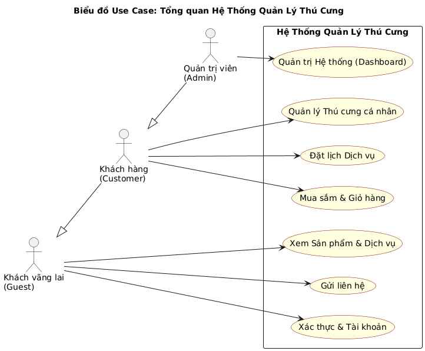

*Hình 2.1: Biểu đồ Use Case tổng quan Hệ thống Quản lý Thú cưng.*

Trong phân hệ Xác thực và Quản lý tài khoản (Hình 2.2), chức năng Đăng nhập được mở rộng (<<extend>>) bởi phương thức Đăng nhập Google OAuth 2.0, đồng thời là điều kiện bắt buộc (<<include>>) đối với các thao tác xem hồ sơ cá nhân và đăng xuất:

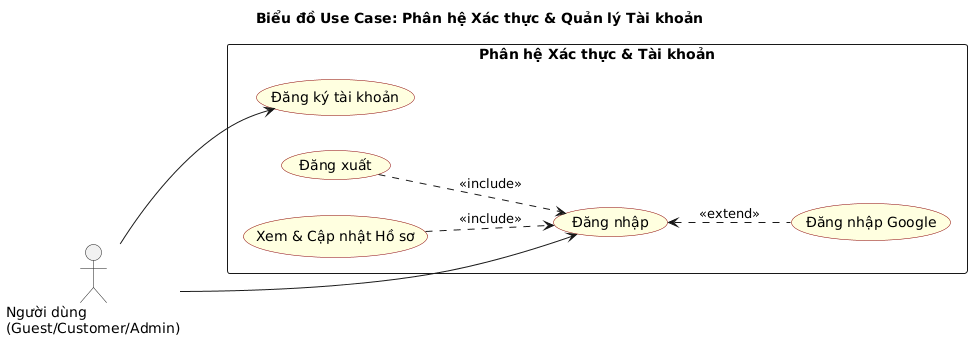

*Hình 2.2: Biểu đồ Use Case phân hệ Xác thực & Quản lý Tài khoản.*

Trong phân hệ Quản lý Thú cưng (Hình 2.3), hệ thống phân tách rõ phạm vi dữ liệu: Khách hàng chỉ nhìn thấy, thêm, sửa, xóa các thú cưng thuộc sở hữu của chính mình (lọc theo OwnerId), trong khi Quản trị viên có quyền quản lý toàn bộ hồ sơ thú cưng trên toàn hệ thống:

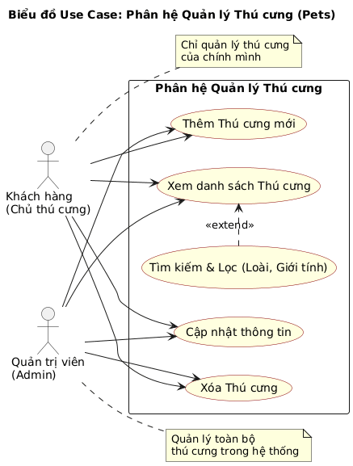

*Hình 2.3: Biểu đồ Use Case phân hệ Quản lý Thú cưng (Pets).*

Trong phân hệ Dịch vụ & Đặt lịch (Hình 2.4), khách hàng thực hiện đặt lịch chăm sóc cho thú cưng của mình và có thể chủ động hủy lịch khi lịch đang ở trạng thái chờ hoặc đã xác nhận; Quản trị viên thực hiện duyệt lịch (Confirmed) và xác nhận hoàn thành dịch vụ (Completed):

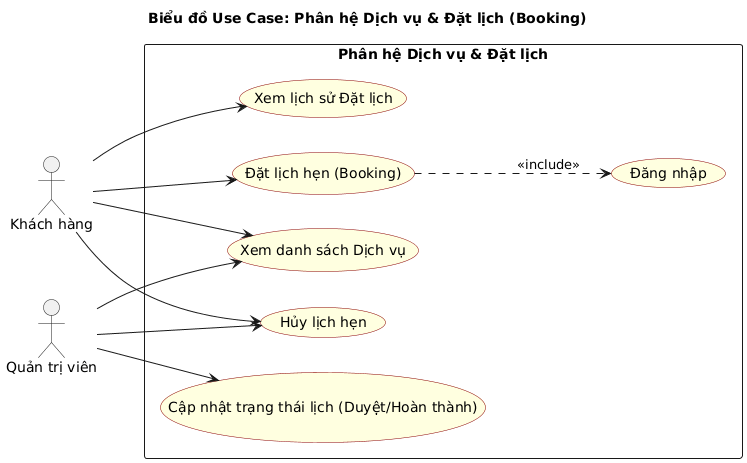

*Hình 2.4: Biểu đồ Use Case phân hệ Dịch vụ & Đặt lịch (Booking).*

Trong phân hệ Cửa hàng Sản phẩm & Giỏ hàng (Hình 2.5) và phân hệ Quản trị Admin Dashboard (Hình 2.6), người dùng có thể lọc sản phẩm theo 4 danh mục, thêm vào giỏ và thanh toán đơn hàng; Quản trị viên theo dõi báo cáo thống kê tổng hợp và điều phối toàn bộ hoạt động của trung tâm:

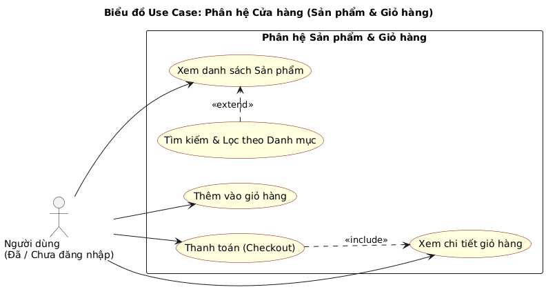

*Hình 2.5: Biểu đồ Use Case phân hệ Cửa hàng (Sản phẩm & Giỏ hàng).*

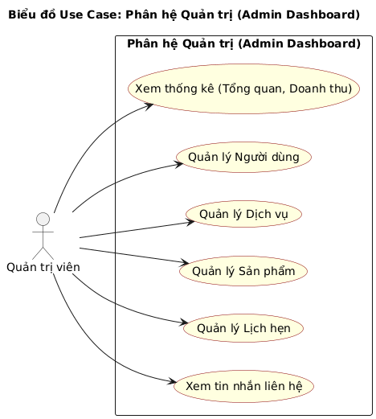

*Hình 2.6: Biểu đồ Use Case phân hệ Quản trị hệ thống (Admin Dashboard).*

### 2.4. Thiết kế Biểu đồ Hoạt động (Activity Diagrams)

Các biểu đồ hoạt động dưới đây đặc tả chi tiết luồng điều khiển và các điểm kiểm tra hợp lệ dữ liệu giữa Người dùng và Hệ thống cho 4 quy trình nghiệp vụ quan trọng nhất:

1. Quy trình Đăng ký tài khoản mới (Hình 2.7): Hệ thống kiểm tra đầy đủ các trường bắt buộc (Họ tên, Email, Mật khẩu), truy vấn bảng Users để đảm bảo Email chưa bị trùng lặp, khởi tạo tài khoản với vai trò mặc định Customer và trả về Token đăng nhập ngay lập tức.

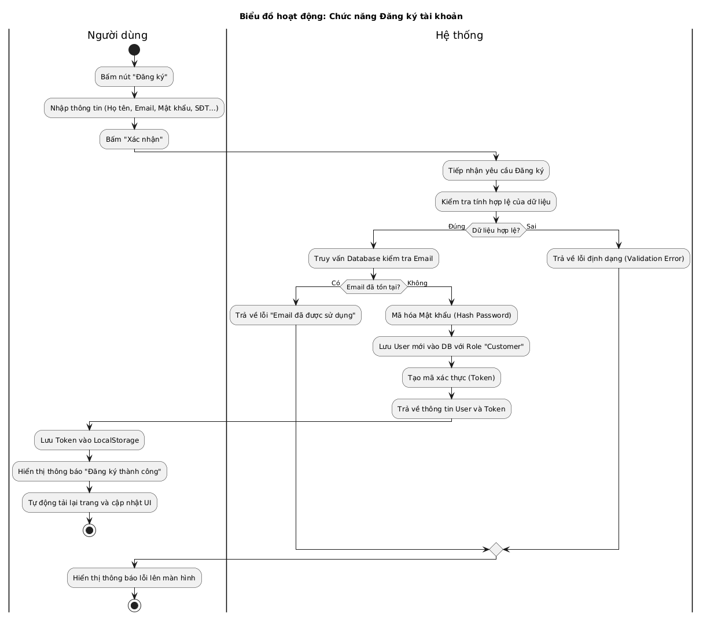

*Hình 2.7: Biểu đồ hoạt động chức năng Đăng ký tài khoản.*

2. Quy trình Thêm hồ sơ Thú cưng mới (Hình 2.8): Trước khi gửi yêu cầu POST /api/pets, giao diện tự động đồng bộ phiên người dùng (syncUserSession) và chuẩn hóa số thập phân của cân nặng (ví dụ 3,5kg -> 3.5kg). Tại Backend, hệ thống kiểm tra tính hợp lệ của tên thú cưng, tự động gán ảnh minh họa mặc định theo loài nếu người dùng để trống URL ảnh, đảm bảo OwnerId tồn tại trong bảng Users rồi lưu vào SQL Server.

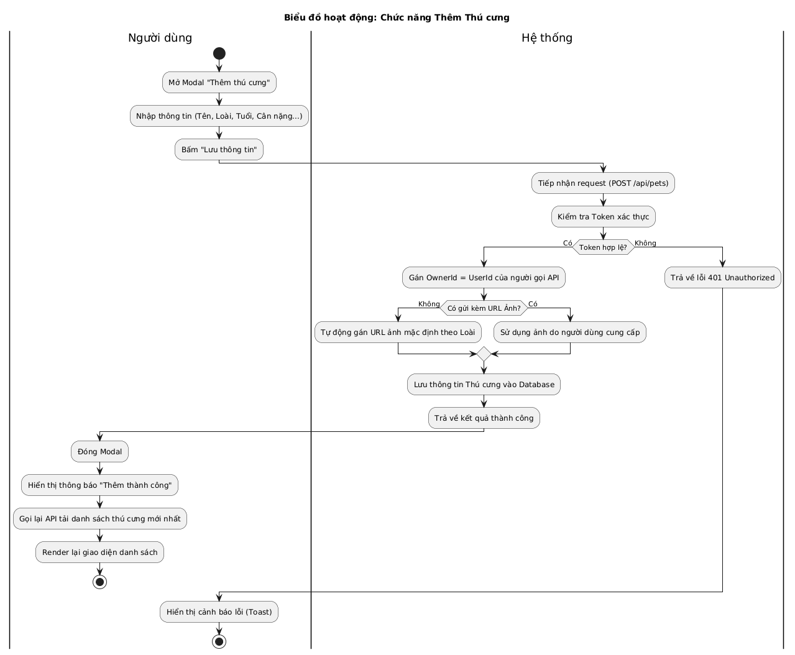

*Hình 2.8: Biểu đồ hoạt động chức năng Thêm hồ sơ Thú cưng.*

3. Quy trình Đặt lịch hẹn dịch vụ (Hình 2.9): Khi khách hàng nhấn Đặt lịch, hệ thống kiểm tra trạng thái đăng nhập và chỉ tải danh sách thú cưng thuộc sở hữu của khách hàng đó vào hộp chọn. Nếu khách hàng chưa có thú cưng nào, hệ thống tự động mở biểu mẫu nhắc thêm hồ sơ thú cưng trước. Sau khi gửi POST /api/appointments, hệ thống đối chiếu PetId, ServiceId, lấy đơn giá dịch vụ gán vào TotalPrice và lưu bản ghi ở trạng thái Pending.

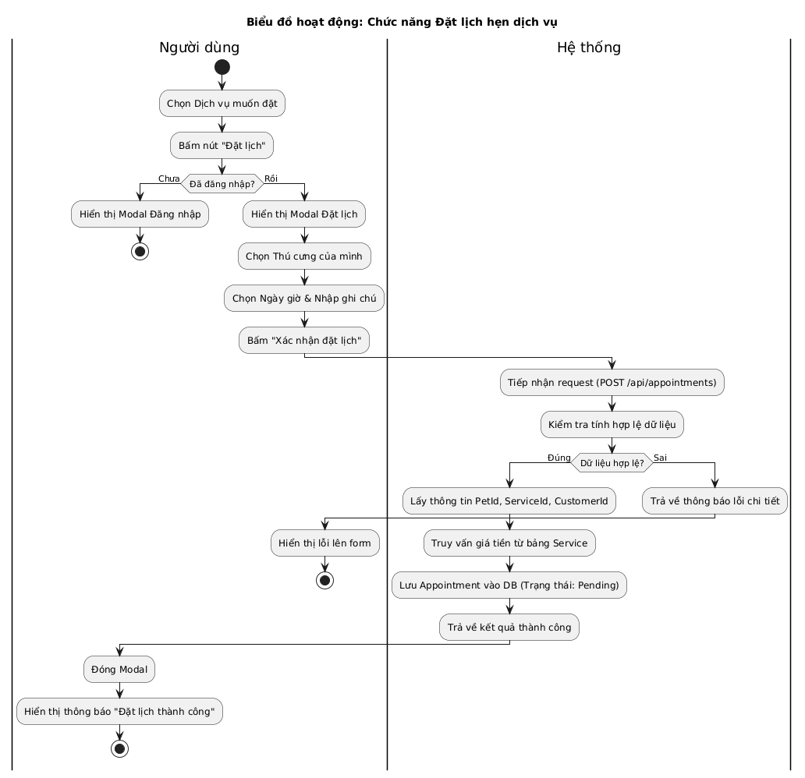

*Hình 2.9: Biểu đồ hoạt động chức năng Đặt lịch hẹn dịch vụ.*

4. Quy trình Thanh toán đơn hàng Pet Shop (Hình 2.10): Sau khi kiểm tra thông tin người nhận ở phía Client, giao diện gửi danh sách mã sản phẩm và số lượng đặt mua lên endpoint POST /api/products/checkout. Backend kiểm tra số lượng tồn kho (StockQuantity) của từng mặt hàng, khấu trừ tồn kho thực tế trong bảng Products, tạo bản ghi đơn hàng mới trong bảng ProductOrders (trạng thái Completed) và cộng dồn doanh thu vào Dashboard trước khi trả kết quả để Client xóa giỏ hàng.

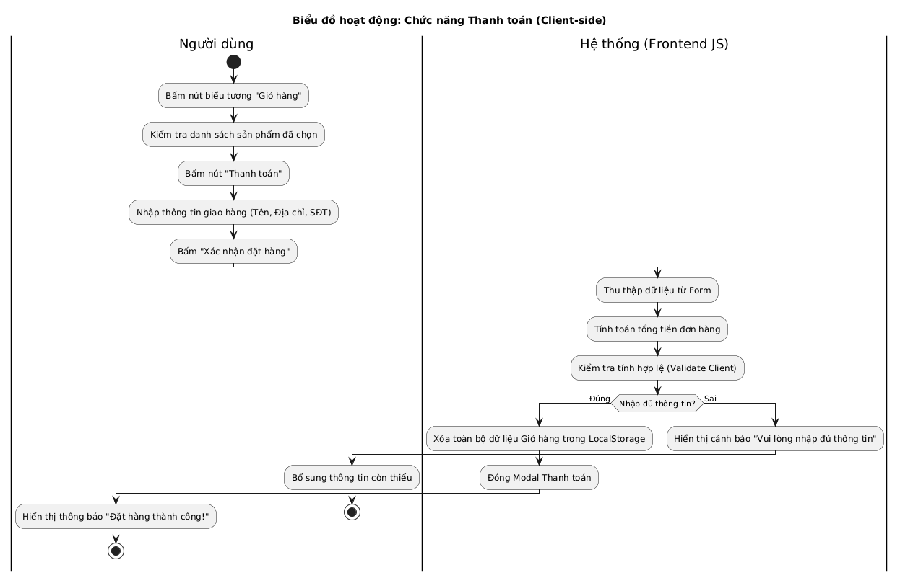

*Hình 2.10: Biểu đồ hoạt động chức năng Thanh toán đơn hàng.*

### 2.5. Thiết kế Biểu đồ Tuần tự (Sequence Diagrams) & Biểu đồ Trạng thái

Các biểu đồ tuần tự dưới đây mô tả chi tiết thứ tự trao đổi thông điệp HTTP/JSON giữa các thành phần Giao diện (Frontend SPA), Dịch vụ xác thực Google, Máy chủ ứng dụng (ASP.NET Core Web API) và Cơ sở dữ liệu (SQL Server 2022):

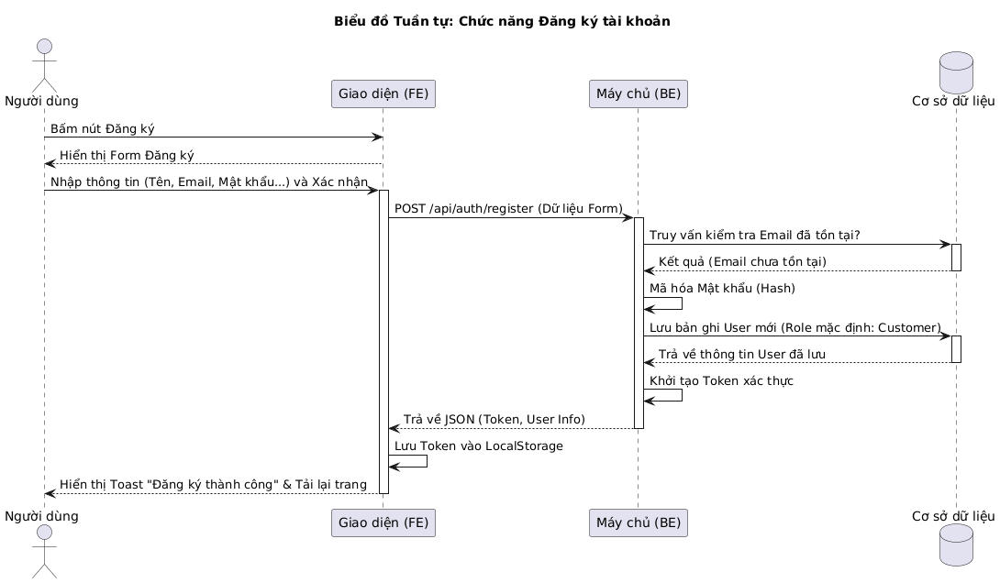

*Hình 2.11: Biểu đồ tuần tự chức năng Đăng ký tài khoản.*

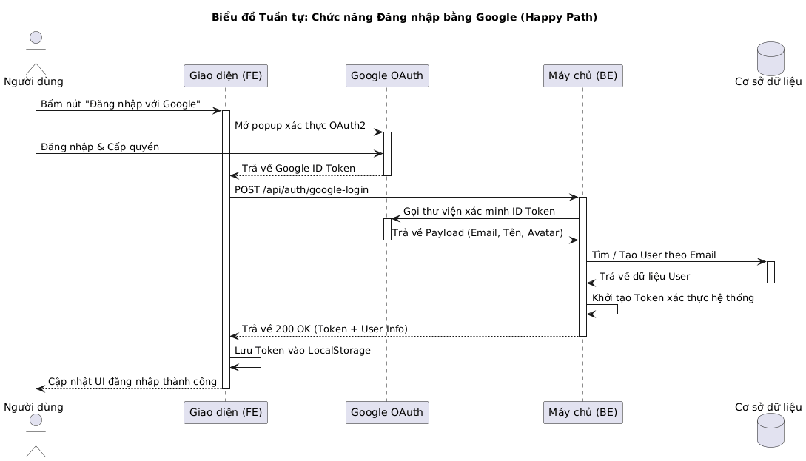

*Hình 2.12: Biểu đồ tuần tự chức năng Đăng nhập bằng Google OAuth 2.0.*

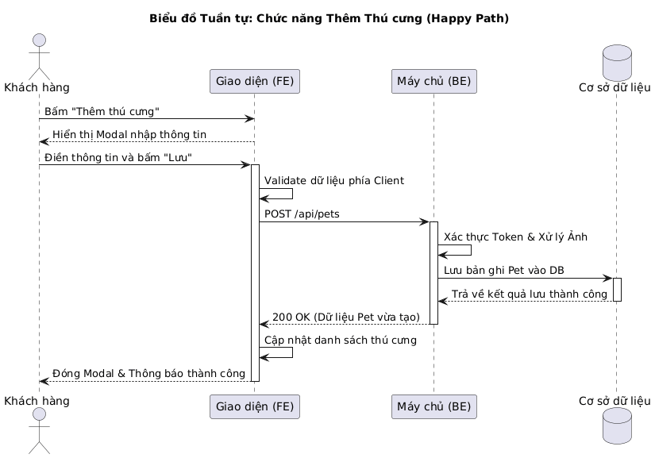

*Hình 2.13: Biểu đồ tuần tự chức năng Thêm hồ sơ Thú cưng.*

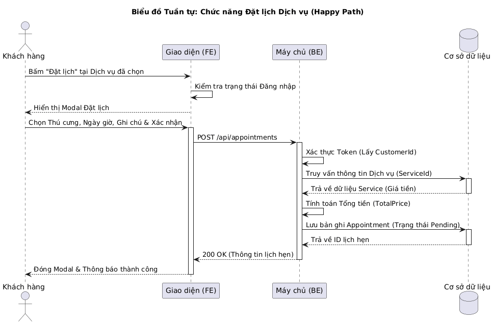

*Hình 2.14: Biểu đồ tuần tự chức năng Đặt lịch dịch vụ chăm sóc.*

Biểu đồ trạng thái (State Machine - Hình 2.15) mô hình hóa vòng đời của một Lịch hẹn dịch vụ từ khi khởi tạo ở trạng thái Pending (Chờ xác nhận), chuyển sang Confirmed (Đã xác nhận) khi Admin duyệt, và kết thúc tại Completed (Đã hoàn thành - ghi nhận doanh thu) hoặc Cancelled (Đã hủy bởi khách hàng hoặc Admin):

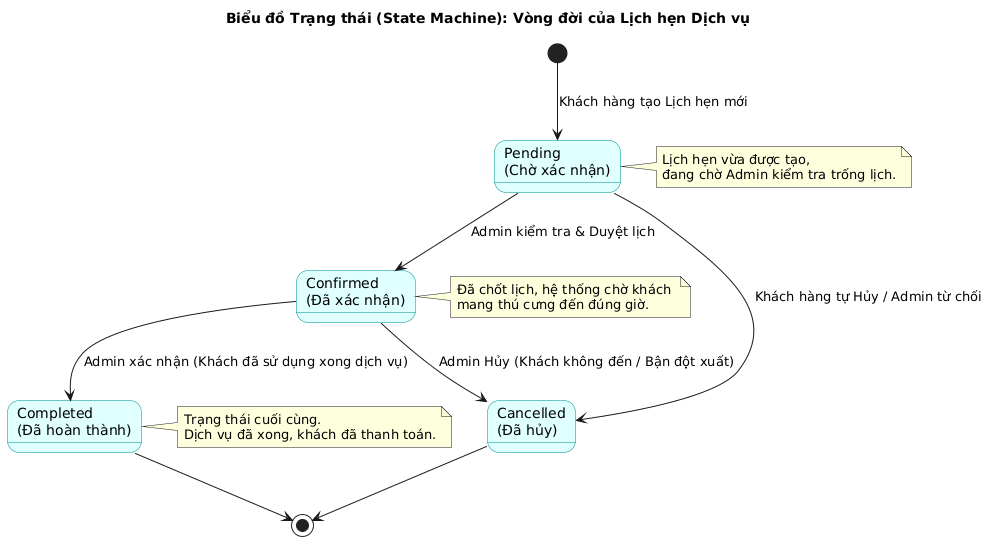

*Hình 2.15: Biểu đồ trạng thái (State Machine) vòng đời của Lịch hẹn dịch vụ.*

---

## CHƯƠNG 3: KIẾN TRÚC HỆ THỐNG VÀ CÔNG NGHỆ SỬ DỤNG

### 3.1. Mô hình kiến trúc tổng thể

Dự án được xây dựng theo kiến trúc phân tầng hiện đại (Layered RESTful Architecture) kết hợp giao diện Single Page Application (SPA) và hạ tầng DevOps Container hóa. Toàn bộ hệ thống khi vận hành đầy đủ bao gồm 9 Docker Containers được phân chia thành 3 cụm chức năng (App Cluster, CI/CD Cluster, Monitoring Cluster) giao tiếp thông suốt trên cùng mạng ảo bridge mang tên petnet:

- Tầng Giao diện (Presentation Layer - Vanilla JS SPA): Phục vụ trực tiếp từ thư mục wwwroot của Kestrel Web Server, giao tiếp bất đồng bộ với Backend hoàn toàn qua chuẩn RESTful JSON API.
- Tầng Điều phối API (Controller Layer - ASP.NET Core 8.0): Gồm 7 API Controllers chuyên biệt (Auth, Pets, Services, Products, Appointments, Contact, Dashboard) cùng 2 endpoint vận hành (/health và /metrics).
- Tầng Truy cập Dữ liệu (Data Access Layer - EF Core 8.0.8): Sử dụng lớp PetDbContext ánh xạ Code-First tới 7 bảng thực thể trong Microsoft SQL Server 2022, đi kèm cơ chế tự động chuyển đổi dự phòng (Auto-Fallback) sang In-Memory Database.
- Tầng Tự động hóa CI/CD & Giám sát (DevOps & Observability Layer): Jenkins điều phối quy trình Build - Unit Test - SonarQube Scan - Docker Packaging - Local/SSH Deployment, trong khi Prometheus & Grafana thu thập và trực quan hóa chỉ số vận hành.

### 3.2. Công nghệ Backend và Kiểm thử

- Nền tảng & Ngôn ngữ: C# 12 trên nền tảng .NET 8.0 (Long-Term Support - LTS) với hiệu năng xử lý bất đồng bộ (async/await) vượt trội.
- ORM & Cơ sở dữ liệu: Microsoft.EntityFrameworkCore.SqlServer (8.0.8) kết hợp Microsoft.EntityFrameworkCore.InMemory (8.0.8). Cấu hình EnableRetryOnFailure (tối đa 5 lần thử lại) giúp kết nối bền vững khi container SQL Server đang khởi động.
- Xử lý JSON & Tuần tự hóa: System.Text.Json được cấu hình ReferenceHandler.IgnoreCycles kết hợp thuộc tính [JsonIgnore] trên các thuộc tính điều hướng ngược (Navigation Properties), triệt tiêu hoàn toàn lỗi vòng lặp tham chiếu giữa User, Pet và Appointment.
- Xác thực & Bảo mật: Kết hợp JWT Token, HTTP-Only Session Cookie và thư viện chính thức Google.Apis.Auth (1.75.0) để xác thực chữ ký số của Google ID Token.
- Tài liệu hóa API & Giám sát: Swashbuckle.AspNetCore (6.7.3) cung cấp giao diện Swagger UI tại /swagger; prometheus-net.AspNetCore (8.2.1) tự động đo đếm lưu lượng và độ trễ của từng HTTP endpoint.
- Kiểm thử tự động & Độ phủ mã nguồn: Dự án kiểm thử riêng biệt tests/PetManagement.Tests sử dụng xUnit (2.9.0) kết hợp coverlet.msbuild (6.0.2) để xuất báo cáo độ phủ định dạng OpenCover XML phục vụ SonarQube.

### 3.3. Công nghệ Frontend (SPA)

- HTML5 & CSS3 Custom Properties: Thiết kế giao diện chuẩn Responsive trên mọi kích thước màn hình, sử dụng hệ thống biến CSS (--primary, --bg-card, --text-main, --border-glass) hỗ trợ chuyển đổi tức thì giữa Giao diện Sáng (Light Mode) và Giao diện Tối (Dark Mode).
- Vanilla JavaScript (ES6+): Quản lý trạng thái tập trung qua đối tượng state trong wwwroot/js/app.js (quản lý phiên đăng nhập, bộ lọc phân trang thú cưng, bộ lọc sản phẩm, giỏ hàng riêng theo từng userId và bảng quản trị Admin) mà không phụ thuộc vào các thư viện nặng bên ngoài.

### 3.4. Bảng tổng hợp Stack công nghệ và Đánh giá tương thích

| Thành phần | Công nghệ / Thư viện | Phiên bản | Vai trò & Tính tương thích trong hệ thống |
| --- | --- | --- | --- |
| Web Backend | ASP.NET Core Web API | 8.0 LTS | Xử lý nghiệp vụ RESTful API, phục vụ file tĩnh SPA và tích hợp middleware Prometheus. |
| ORM | Entity Framework Core | 8.0.8 | Ánh xạ đối tượng - quan hệ (Code-First), tự động khởi tạo schema và seed dữ liệu ban đầu. |
| Primary DB | MS SQL Server | 2022 Latest | Lưu trữ dữ liệu bền vững qua Docker volume sqlserver_data, cấu hình healthcheck sqlcmd. |
| Fallback DB | EF Core InMemory | 8.0.8 | Cơ sở dữ liệu dự phòng tự động kích hoạt sau 3 giây nếu không tìm thấy máy chủ SQL Server. |
| OAuth 2.0 | Google.Apis.Auth | 1.75.0 | Xác thực Google ID Token chuẩn OpenID Connect kết hợp chế độ Demo OAuth2 linh hoạt. |
| Unit Testing | xUnit + Coverlet | 2.9.0 / 6.0.2 | Thực thi 16 bài kiểm thử tự động bao phủ toàn bộ 7 API Controllers, xuất file OpenCover. |
| CI/CD Server | Jenkins LTS (Custom) | JDK 17 + .NET 8 | Image tùy biến tích hợp sẵn .NET 8 SDK, dotnet-sonarscanner, Docker CLI và OpenSSH Client. |
| Code Quality | SonarQube + Postgres | 26.x + PG 15 | Phân tích mã tĩnh, kiểm tra lỗ hổng bảo mật, độ phủ test và phản hồi Quality Gate qua Webhook. |
| Monitoring | Prometheus + Grafana | Latest | Thu thập metrics từ Web App, cAdvisor, Node Exporter và hiển thị trên Dashboard 8 biểu đồ. |

---

## CHƯƠNG 4: THIẾT KẾ CẤU TRÚC CƠ SỞ DỮ LIỆU (DATABASE SCHEMA)

### 4.1. Kiến trúc PetDbContext và Toàn vẹn dữ liệu

Cơ sở dữ liệu PetManagementDb được định nghĩa thông qua lớp PetDbContext (Data/PetDbContext.cs) theo phương pháp Code-First với 7 tập thực thể (DbSet): Users, Pets, Services, Appointments, Products, ProductOrders và ContactMessages. Khi ứng dụng khởi động, lệnh dbContext.Database.EnsureCreated() tự động kiểm tra, khởi tạo đầy đủ cấu trúc bảng, khóa ngoại và nạp dữ liệu mẫu ban đầu (Data Seeding).

### 4.2. Bảng Users (Người dùng hệ thống)

Lưu trữ thông tin tài khoản của Quản trị viên và Khách hàng, hỗ trợ cả đăng nhập nội bộ lẫn tài khoản liên kết Google OAuth 2.0:

| Tên cột | Kiểu dữ liệu | Ràng buộc | Mô tả ý nghĩa |
| --- | --- | --- | --- |
| Id | int | PK, Identity(1,1) | Mã định danh duy nhất của người dùng. |
| FullName | nvarchar(max) | Not Null | Họ và tên đầy đủ hiển thị trên giao diện. |
| Email | nvarchar(max) | Not Null, Unique logic | Địa chỉ Email dùng để đăng nhập và định danh tài khoản. |
| PasswordHash | nvarchar(max) | Not Null | Mật khẩu hoặc cờ đánh dấu tài khoản OAuth2 / Synced Session. |
| Role | nvarchar(max) | Default: 'Customer' | Vai trò phân quyền trong hệ thống ('Admin' hoặc 'Customer'). |
| Phone | nvarchar(max) | Not Null | Số điện thoại liên hệ của người dùng. |
| Address | nvarchar(max) | Not Null | Địa chỉ liên hệ và giao hàng mặc định. |
| AvatarUrl | nvarchar(max) | Not Null | Đường dẫn ảnh đại diện (tự động đồng bộ từ Google nếu dùng OAuth2). |
| OAuthProvider | nvarchar(max) | Default: 'Local' | Nguồn xác thực tài khoản ('Local' hoặc 'Google'). |
| CreatedAt | datetime2 | Default: UtcNow | Thời điểm tạo tài khoản. |

### 4.3. Bảng Pets (Hồ sơ Thú cưng)

Lưu trữ thông tin chi tiết của từng thú cưng, liên kết trực tiếp với chủ sở hữu thông qua khóa ngoại OwnerId:

| Tên cột | Kiểu dữ liệu | Ràng buộc | Mô tả ý nghĩa |
| --- | --- | --- | --- |
| Id | int | PK, Identity(1,1) | Mã hồ sơ thú cưng (Id 1..4 là dữ liệu mẫu, Id > 4 là dữ liệu người dùng nhập). |
| Name | nvarchar(max) | Not Null | Tên gọi của thú cưng (ví dụ: Bé Bông, Miu Miu, Mochi, Loki, Ngáo). |
| Species | nvarchar(max) | Default: 'Chó' | Loài thú cưng ('Chó', 'Mèo', 'Thỏ', 'Khác'). |
| Breed | nvarchar(max) | Not Null | Giống thú cưng chi tiết (ví dụ: Poodle, Husky, Corgi, Mèo Anh Lông Ngắn). |
| AgeYears | int | Not Null | Tuổi của thú cưng (tính theo năm). |
| WeightKg | float (double) | Not Null | Cân nặng hiện tại của thú cưng (tính bằng kg, hỗ trợ số thập phân). |
| Gender | nvarchar(max) | Default: 'Đực' | Giới tính thú cưng ('Đực' hoặc 'Cái'). |
| HealthNotes | nvarchar(max) | Not Null | Ghi chú tình trạng sức khỏe, lịch sử tiêm phòng vắc-xin và thói quen. |
| ImageUrl | nvarchar(max) | Not Null | Đường dẫn hình ảnh thú cưng (tự động gán ảnh mặc định theo loài nếu trống). |
| OwnerId | int | FK -> Users(Id), Cascade | Mã chủ sở hữu thú cưng trong bảng Users. |
| CreatedAt | datetime2 | Default: UtcNow | Thời điểm khởi tạo hồ sơ. |

### 4.4. Bảng Services (Danh mục Dịch vụ chăm sóc & khám chữa bệnh)

| Tên cột | Kiểu dữ liệu | Ràng buộc | Mô tả ý nghĩa |
| --- | --- | --- | --- |
| Id | int | PK, Identity(1,1) | Mã định danh gói dịch vụ. |
| Name | nvarchar(max) | Not Null | Tên gói dịch vụ (Spa, Khám tổng quát, Khách sạn VIP, Tẩy giun...). |
| Category | nvarchar(max) | Default: 'Spa & Grooming' | Nhóm dịch vụ ('Spa & Grooming', 'Khám Sức Khỏe', 'Khách Sạn Thú Cưng'). |
| Price | decimal(18,2) | Not Null (> 0) | Đơn giá dịch vụ (VNĐ). |
| DurationMinutes | int | Default: 45 | Thời gian thực hiện dự kiến (tính bằng phút). |
| Description | nvarchar(max) | Not Null | Mô tả chi tiết quy trình và quyền lợi của gói dịch vụ. |
| ImageUrl | nvarchar(max) | Not Null | Ảnh minh họa gói dịch vụ. |
| IsActive | bit (bool) | Default: true | Trạng thái hoạt động (hỗ trợ Soft-Delete khi ngưng cung cấp dịch vụ). |

### 4.5. Bảng Products (Sản phẩm Cửa hàng Pet Shop)

| Tên cột | Kiểu dữ liệu | Ràng buộc | Mô tả ý nghĩa |
| --- | --- | --- | --- |
| Id | int | PK, Identity(1,1) | Mã định danh sản phẩm. |
| Name | nvarchar(max) | Not Null | Tên sản phẩm thương mại. |
| Category | nvarchar(max) | Default: 'Thức Ăn' | Danh mục ('Thức Ăn', 'Đồ Chơi', 'Phụ Kiện', 'Sức Khỏe'). |
| Price | decimal(18,2) | Not Null (> 0) | Giá bán lẻ niêm yết (VNĐ). |
| StockQuantity | int | Default: 50 | Số lượng tồn kho thực tế (tự động kiểm tra và trừ khi khách thanh toán). |
| Description | nvarchar(max) | Not Null | Mô tả thành phần, công dụng của sản phẩm. |
| ImageUrl | nvarchar(max) | Not Null | Hình ảnh sản phẩm. |
| Rating | float (double) | Default: 4.8 | Điểm đánh giá chất lượng sản phẩm (thang điểm 1.0 - 5.0). |

### 4.6. Bảng Appointments (Lịch hẹn dịch vụ)

Bảng giao dịch trung tâm liên kết giữa Khách hàng (CustomerId), Thú cưng (PetId) và Gói dịch vụ (ServiceId):

| Tên cột | Kiểu dữ liệu | Ràng buộc | Mô tả ý nghĩa |
| --- | --- | --- | --- |
| Id | int | PK, Identity(1,1) | Mã đơn đặt lịch hẹn. |
| PetId | int | FK -> Pets(Id), Restrict | Mã thú cưng sử dụng dịch vụ. |
| ServiceId | int | FK -> Services(Id), Restrict | Mã gói dịch vụ được đặt. |
| CustomerId | int | FK -> Users(Id), Cascade | Mã khách hàng đặt lịch. |
| AppointmentDate | datetime2 | Not Null | Ngày và giờ hẹn thực hiện dịch vụ. |
| Status | nvarchar(max) | Default: 'Pending' | Trạng thái lịch hẹn ('Pending', 'Confirmed', 'Completed', 'Cancelled'). |
| Notes | nvarchar(max) | Not Null | Ghi chú yêu cầu đặc biệt của khách hàng. |
| TotalPrice | decimal(18,2) | Not Null | Chi phí lịch hẹn (chốt theo giá dịch vụ tại thời điểm đặt). |
| CreatedAt | datetime2 | Default: UtcNow | Thời điểm tạo lịch hẹn. |

### 4.7. Bảng ProductOrders (Đơn hàng Cửa hàng) & Bảng ContactMessages (Liên hệ)

Khác với bản thiết kế sơ khởi ban đầu (sử dụng bảng Invoices giả định), hệ thống thực tế tách bạch doanh thu dịch vụ (tính từ bảng Appointments có Status = 'Completed') và doanh thu bán lẻ sản phẩm thông qua bảng ProductOrders, đồng thời lưu trữ phản hồi khách hàng tại bảng ContactMessages:

| Bảng dữ liệu | Các cột thuộc tính chính | Vai trò trong nghiệp vụ thực tế |
| --- | --- | --- |
| ProductOrders | Id (PK), CustomerName, CustomerPhone, ShippingAddress, PaymentMethod ('COD'/'BANK'), TotalAmount (decimal), Status ('Completed'), CreatedAt | Lưu trữ toàn bộ đơn đặt hàng từ giỏ hàng Pet Shop sau khi đã kiểm tra và khấu trừ số lượng tồn kho của từng sản phẩm. |
| ContactMessages | Id (PK), Name, Email, Subject, Message, CreatedAt, IsRead (bool) | Lưu trữ tin nhắn liên hệ và yêu cầu tư vấn của khách hàng gửi từ trang chủ để bộ phận chăm sóc khách hàng xử lý. |

---

## CHƯƠNG 5: CHI TIẾT CÁC MODULE CHỨC NĂNG & HỆ THỐNG RESTFUL API

### 5.1. Module Xác thực & Đồng bộ phiên (AuthApiController - /api/auth)

Module xác thực được cài đặt tại Controllers/AuthApiController.cs cung cấp cơ chế xác thực đa kênh và đảm bảo tính nhất quán dữ liệu giữa trình duyệt và SQL Server:

- POST /api/auth/login & POST /api/auth/register: Kiểm tra thông tin đăng nhập hoặc tạo mới tài khoản người dùng, cấp phát chuỗi Token định danh kèm thiết lập Cookie HTTP-Only (AuthToken) có thời hạn 7 ngày.
- GET /api/auth/google-config, POST /api/auth/google-login & POST /api/auth/oauth2-login: Xác thực Google ID Token thông qua GoogleJsonWebSignature.ValidateAsync() hoặc chế độ Demo OAuth2, tự động tạo mới hoặc cập nhật ảnh đại diện người dùng trong bảng Users.
- POST /api/auth/sync (Đồng bộ phiên thông minh): Giải quyết triệt để bài toán lệch mã người dùng (UserId) trong localStorage khi khởi tạo lại container SQL Server mới. Ngay khi tải trang hoặc trước khi lưu thú cưng, trình duyệt gọi endpoint này để đảm bảo tài khoản hiện tại luôn tồn tại hợp lệ trong bảng dbo.Users.

### 5.2. Module Quản lý Thú cưng (PetsApiController - /api/pets)

Module quản lý thú cưng (Controllers/PetsApiController.cs) cung cấp đầy đủ các thao tác CRUD nâng cao kèm xử lý toàn vẹn khóa ngoại:

- GET /api/pets: Hỗ trợ tìm kiếm đa trường (Name, Breed, HealthNotes), lọc theo loài (Species) và giới tính (Gender), sắp xếp theo 5 tiêu chí (newest, name_asc, age_asc, age_desc, weight_desc) và phân trang (PagedResult). Tự động lọc theo ownerId đối với tài khoản Customer và trả về toàn bộ danh sách đối với tài khoản Admin.
- POST /api/pets & PUT /api/pets/{id}: Chuẩn hóa dữ liệu đầu vào, tự động gán hình ảnh mặc định theo loài nếu người dùng không nhập URL ảnh, và tự động kiểm tra/đồng bộ OwnerId hợp lệ trước khi lưu.
- DELETE /api/pets/{id} (Xóa đơn lẻ) & DELETE /api/pets/custom (Xóa hàng loạt thú cưng mới nhập): Do bảng Appointments có ràng buộc khóa ngoại Restrict tới bảng Pets, trước khi xóa một hoặc nhiều thú cưng, Controller tự động truy vấn và xóa các lịch hẹn liên quan của thú cưng đó, giúp thao tác xóa trên giao diện thẻ Card, trong Modal chỉnh sửa hoặc nút 'Xóa Pet Đã Nhập' luôn thực thi thành công 100%.

### 5.3. Module Dịch vụ & Cửa hàng Sản phẩm (ServicesApiController & ProductsApiController)

- Quản lý Dịch vụ (/api/services): Cung cấp các API lấy danh sách dịch vụ đang hoạt động (IsActive = true), thêm mới, cập nhật và xóa mềm (Soft-Delete bằng cách đặt IsActive = false trong DELETE /api/services/{id}) giúp bảo toàn lịch sử các cuộc hẹn cũ.
- Quản lý Sản phẩm & Thanh toán (/api/products & POST /api/products/checkout): Hỗ trợ lọc theo 4 danh mục (Thức Ăn, Đồ Chơi, Phụ Kiện, Sức Khỏe) và phân trang. Khi thanh toán, thuật toán duyệt qua từng sản phẩm trong giỏ, kiểm tra điều kiện product.StockQuantity >= qty (trả về lỗi 400 Bad Request rõ ràng nếu vượt tồn kho), trừ số lượng tồn kho thực tế và ghi nhận đơn hàng vào bảng ProductOrders.

### 5.4. Module Lịch hẹn (AppointmentsApiController) & Thống kê (DashboardApiController)

- Quản lý Lịch hẹn (/api/appointments): Khi khách hàng mở hộp thoại Đặt lịch trên giao diện, hệ thống chỉ nạp danh sách thú cưng thuộc sở hữu của khách hàng đó. Hỗ trợ đầy đủ các API tạo lịch mới (POST), chuyển trạng thái duyệt/hoàn thành (PUT /api/appointments/{id}/status) và hủy lịch (DELETE /api/appointments/{id}).
- Thống kê Quản trị (/api/dashboard/stats): Tính toán thời gian thực tổng số thú cưng, tổng lịch hẹn, số lịch đang chờ duyệt, tổng doanh thu hợp nhất (appointmentRevenue + productRevenue) và danh sách 5 lịch hẹn gần nhất.

### 5.5. Giao diện Người dùng thực tế và Tài liệu hóa Swagger OpenAPI

Hình 5.1 và Hình 5.2 dưới đây là ảnh chụp màn hình thực tế của ứng dụng PetCare Hub và trang tài liệu đặc tả API Swagger UI khi đang vận hành trên container Docker tại cổng 5000:

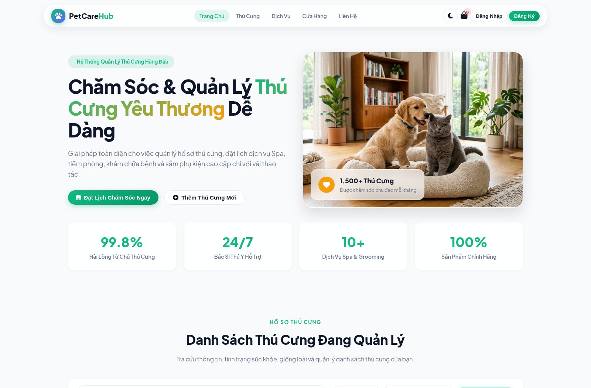

*Hình 5.1: Giao diện trang chủ ứng dụng Quản lý & Chăm sóc Thú cưng PetCare Hub tại http://localhost:5000.*

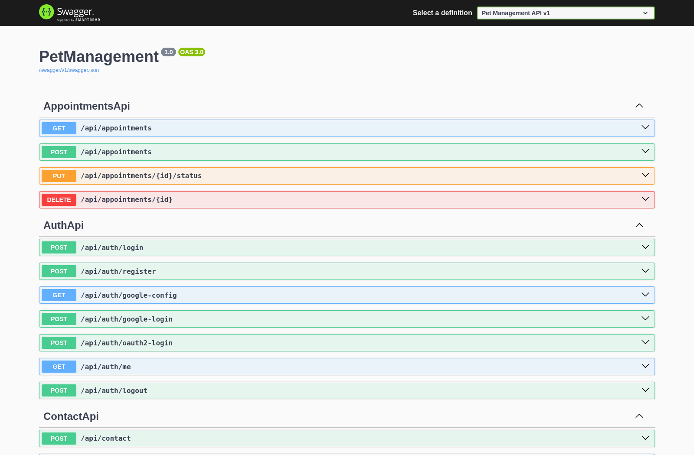

*Hình 5.2: Giao diện Swagger UI đặc tả và kiểm thử trực tiếp toàn bộ hệ thống RESTful API tại http://localhost:5000/swagger.*

---

## CHƯƠNG 6: ĐÓNG GÓI DOCKER VÀ TRIỂN KHAI HỆ THỐNG CI/CD TỰ ĐỘNG (JENKINS, SONARQUBE & SSH DEPLOY)

### 6.1. Kiến trúc Triển khai Container hóa & Quy hoạch 3 cụm Docker Compose

Khắc phục hoàn toàn hạn chế mất dữ liệu khi khởi động lại của mô hình In-Memory đơn lẻ trước đây, dự án đã được nâng cấp lên kiến trúc đa container kết nối với hệ quản trị cơ sở dữ liệu Microsoft SQL Server 2022 chính thức và tích hợp đầy đủ hạ tầng CI/CD - Giám sát:

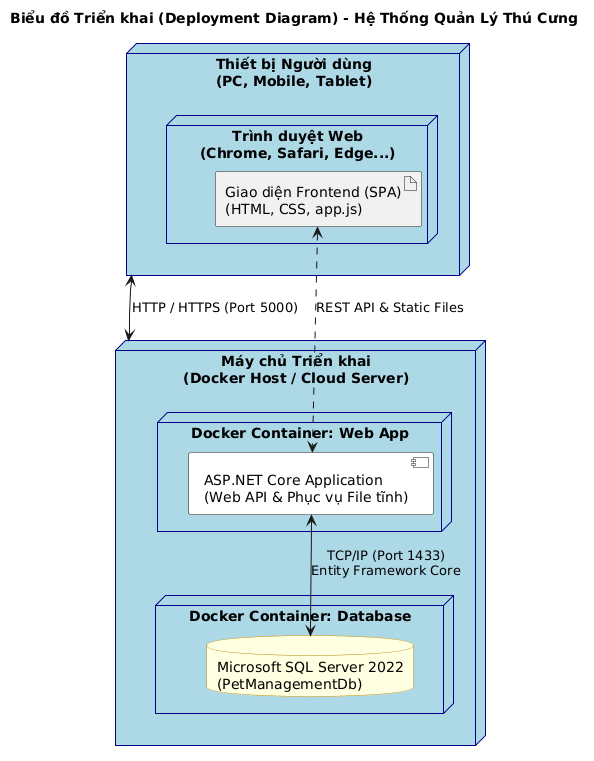

*Hình 6.1: Biểu đồ Triển khai (Deployment Diagram) giữa Trình duyệt, Web App Container và SQL Server 2022 Container.*

Toàn bộ hệ thống gồm 9 containers được định nghĩa trên 3 tệp Docker Compose độc lập nhưng gắn kết qua mạng bridge chung petnet, giúp khởi động toàn bộ bằng một script duy nhất (.\ci\scripts\start-cicd.ps1):

| Cụm tệp Compose | Tên Container | Image sử dụng | Cổng Host -> Container | Chức năng nhiệm vụ |
| --- | --- | --- | --- | --- |
| docker-compose.yml (Cụm Ứng dụng) | petmanagement_webapp | petmanagement_webapp:latest | 5000 -> 80 | Ứng dụng chính ASP.NET Core 8.0 + Giao diện SPA + endpoint /health và /metrics. |
| docker-compose.yml (Cụm Ứng dụng) | petmanagement_sqlserver | mcr.microsoft.com/mssql/server:2022-latest | 1433 -> 1433 | CSDL SQL Server 2022 lưu trữ bền vững trên volume sqlserver_data, có healthcheck. |
| docker-compose.ci.yml (Cụm CI/CD) | petmanagement_jenkins | petmanagement_jenkins:latest | 8090 -> 8080, 50000 -> 50000 | Máy chủ tự động hóa Jenkins LTS tích hợp .NET 8 SDK, SonarScanner, Docker CLI, SSH. |
| docker-compose.ci.yml (Cụm CI/CD) | petmanagement_sonarqube | sonarqube:community | 9000 -> 9000 | Máy chủ phân tích chất lượng mã nguồn tĩnh và kiểm soát Quality Gate. |
| docker-compose.ci.yml (Cụm CI/CD) | petmanagement_sonar_db | postgres:15 | 5432 (nội bộ petnet) | CSDL PostgreSQL 15 lưu trữ dữ liệu phân tích của SonarQube. |
| docker-compose.monitoring.yml (Cụm Giám sát) | petmanagement_prometheus | prom/prometheus:latest | 9091 -> 9090 | Thu thập và lưu trữ chuỗi thời gian (Time-Series) metrics từ 4 targets. |
| docker-compose.monitoring.yml (Cụm Giám sát) | petmanagement_grafana | grafana/grafana:latest | 3001 -> 3000 | Trực quan hóa dữ liệu giám sát với Dashboard 8 biểu đồ tự động nạp sẵn. |
| docker-compose.monitoring.yml (Cụm Giám sát) | petmanagement_cadvisor | gcr.io/cadvisor/cadvisor:latest | 8082 -> 8080 | Giám sát tài nguyên CPU, RAM, Network I/O của từng Docker container. |
| docker-compose.monitoring.yml (Cụm Giám sát) | petmanagement_node_exporter | prom/node-exporter:latest | 9101 -> 9100 | Thu thập thông số tài nguyên phần cứng và hệ điều hành máy chủ Host. |

### 6.2. Kỹ thuật Đóng gói Multi-stage Dockerfile

Tệp Dockerfile của ứng dụng áp dụng kỹ thuật Multi-stage Build gồm 2 giai đoạn tách biệt: giai đoạn build sử dụng image mcr.microsoft.com/dotnet/sdk:8.0 để khôi phục gói NuGet (tận dụng Docker Layer Caching cho tệp PetManagement.csproj), biên dịch và xuất bản mã thực thi ở chế độ Release; giai đoạn final chỉ sử dụng image runtime nhẹ mcr.microsoft.com/dotnet/aspnet:8.0 để chạy tiến trình dotnet PetManagement.dll, giúp giảm hơn 65% dung lượng image triển khai và tăng cường bảo mật.

### 6.3. Cài đặt và Tùy biến Máy chủ Jenkins (ci/jenkins/Dockerfile)

Để Jenkins có thể trực tiếp biên dịch mã nguồn .NET 8, quét SonarQube và điều khiển Docker Engine theo mô hình Docker-outside-of-Docker (DooD), dự án xây dựng một Dockerfile tùy biến riêng tại ci/jenkins/Dockerfile kế thừa từ jenkins/jenkins:lts-jdk17 với các thành phần:

- Cài đặt .NET 8.0 SDK cùng các thư viện hệ thống bắt buộc trên Debian (libicu, libssl3, zlib1g, libgssapi-krb5-2) và cài đặt công cụ toàn cục dotnet-sonarscanner.
- Cài đặt Docker CE CLI, Docker Compose Plugin và OpenSSH Client, đồng thời mount socket /var/run/docker.sock từ máy chủ Host vào container Jenkins.
- Tự động cài đặt bộ plugin chuẩn qua jenkins-plugin-cli (git, workflow-aggregator, docker-workflow, sonar, ssh-agent, credentials-binding) và cấu hình tự động 2 Pipeline job thông qua Groovy Init Hook.

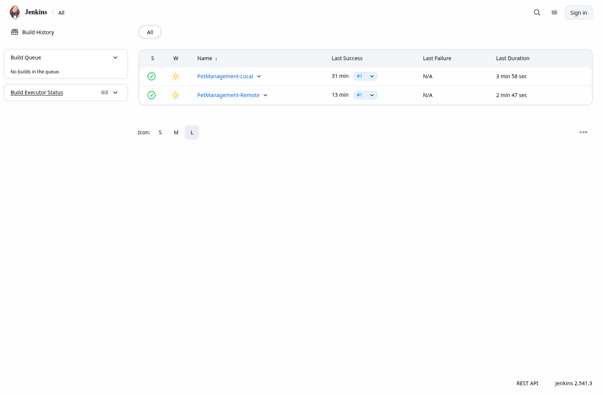

*Hình 6.2: Giao diện Jenkins Dashboard tại http://localhost:8090 với 2 Pipeline (PetManagement-Local & PetManagement-Remote) hoạt động ổn định.*

### 6.4. Thiết kế Pipeline Local (Jenkinsfile - 8 Stages) & Kiểm thử Tự động

Pipeline thứ nhất (PetManagement-Local) được định nghĩa trong tệp Jenkinsfile gồm 8 giai đoạn (Stage) tuần tự, tự động kéo mã nguồn từ GitHub và triển khai trực tiếp lên cụm Docker cục bộ:

- Stage 1 - Checkout: Kéo mã nguồn mới nhất từ nhánh main của kho lưu trữ GitHub (https://github.com/Hoc123421/pet-management-system.git) và ghi nhận thông tin bản commit.
- Stage 2 - Restore & Build: Thực thi dotnet restore và dotnet build PetManagement.csproj -c Release để kiểm tra lỗi cú pháp và biên dịch toàn bộ giải pháp.
- Stage 3 - Unit Test: Chạy bộ 16 kịch bản kiểm thử xUnit trong tests/PetManagement.Tests với tham số /p:CollectCoverage=true /p:CoverletOutputFormat=opencover để kiểm chứng logic của cả 7 API Controllers và xuất báo cáo coverage.opencover.xml.
- Stage 4 - SonarQube Analysis: Kích hoạt dotnet sonarscanner begin, biên dịch lại mã nguồn dưới sự giám sát của Roslyn Analyzer và đẩy kết quả cùng báo cáo độ phủ OpenCover lên máy chủ SonarQube qua dotnet sonarscanner end.
- Stage 5 - Quality Gate: Sử dụng lệnh waitForQualityGate abortPipeline: true để chờ kết quả đánh giá từ SonarQube trả về qua Webhook (http://jenkins:8080/sonarqube-webhook/). Nếu mã nguồn không đạt ngưỡng chất lượng, Pipeline sẽ tự động dừng ngay lập tức.
- Stage 6 - Docker Build: Đóng gói Docker Image mới với thẻ phiên bản petmanagement_webapp:${BUILD_NUMBER} và cập nhật thẻ petmanagement_webapp:latest.
- Stage 7 - Deploy (Local - docker compose): Thực thi docker compose -f docker-compose.yml up -d --no-build để cập nhật container ứng dụng mới nhất kết nối cùng container SQL Server 2022.
- Stage 8 - Health Check: Vòng lặp kiểm tra tự động gọi endpoint http://petmanagement_webapp/health cho đến khi nhận phản hồi HTTP 200 OK {"status":"Healthy"}.

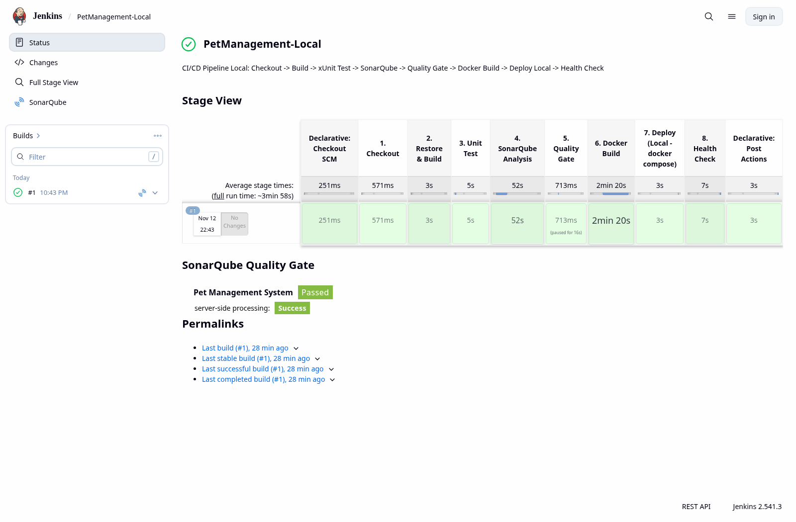

*Hình 6.3: Kết quả thực thi Pipeline PetManagement-Local hoàn tất 8/8 stages xanh lá (100% Success).*

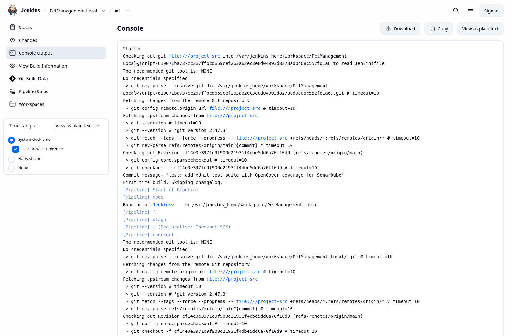

*Hình 6.4: Nhật ký Console Output của Jenkins ghi nhận quá trình Build, Unit Test, SonarQube Quality Gate OK, Docker Compose Deploy và Health Check.*

### 6.5. Tích hợp SonarQube Phân tích Mã tĩnh và Kiểm soát Quality Gate

Máy chủ SonarQube (http://localhost:9000) được tích hợp hai chiều với Jenkins thông qua Authentication Token (sonar-token) và Webhook. Kết quả phân tích thực tế trên dự án PetManagement đạt mức xếp hạng A cao nhất trên tất cả các tiêu chí:

- Quality Gate Status: PASSED (Vượt qua toàn bộ các tiêu chuẩn kiểm định chất lượng).
- Security (Bảo mật) & Reliability (Độ tin cậy): 0 Vulnerabilities (Rating A), 0 Bugs (Rating A).
- Maintainability (Khả năng bảo trì): Rating A với tỷ lệ trùng lặp mã nguồn (Duplications) là 0.0%.
- Code Coverage (Độ phủ kiểm thử tự động): Đạt 75.2% trên toàn bộ mã nguồn nghiệp vụ nhờ bộ kiểm thử xUnit.

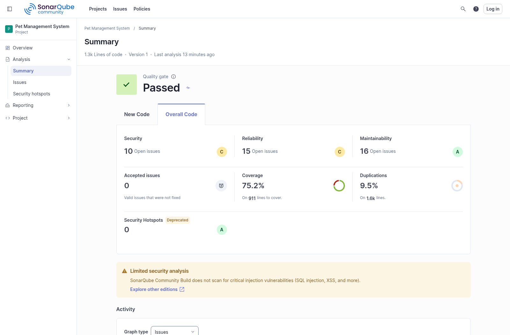

*Hình 6.5: Kết quả phân tích mã nguồn trên SonarQube Dashboard đạt Quality Gate: Passed với độ phủ kiểm thử 75.2%.*

### 6.6. Tự động Triển khai lên Server Public qua SSH (Jenkinsfile.remote)

Đáp ứng yêu cầu triển khai phần mềm lên máy chủ từ xa (VPS / Cloud Server có địa chỉ IP hoặc tên miền Public), dự án xây dựng Pipeline thứ hai mang tên PetManagement-Remote sử dụng tệp kịch bản Jenkinsfile.remote. Pipeline này giữ nguyên 6 stage kiểm định chất lượng đầu tiên và nâng cấp Stage 7 & Stage 8 để triển khai từ xa qua giao thức SSH:

- Tham số hóa linh hoạt: Cho phép cấu hình trực tiếp trên giao diện Jenkins các tham số SERVER_HOST (IP/Domain public của server đích), SERVER_USER (tài khoản SSH), DEPLOY_DIR (/opt/petmanagement) và cờ DEPLOY_MONITORING.
- Stage 7 - Deploy to Public Server (SSH): Sử dụng Jenkins Credential prod-server-ssh (SSH Username with Private Key) để thực hiện tuần tự 4 bước tự động: (1) Tạo thư mục đích qua ssh mkdir -p; (2) Sao chép tệp docker-compose.yml và cấu hình giám sát lên server qua scp; (3) Nén và truyền trực tiếp Docker Image vừa build qua đường ống docker save | gzip | ssh 'gunzip | docker load' mà không phụ thuộc Docker Hub bên ngoài; (4) Kích hoạt từ xa lệnh docker compose -f docker-compose.yml up -d --no-build --remove-orphans.
- Stage 8 - Public Health Check: Từ Jenkins thực hiện truy vấn kiểm tra sức khỏe trực tiếp vào địa chỉ public http://${SERVER_HOST}:5000/health để xác nhận phần mềm đã sẵn sàng phục vụ người dùng cuối qua Internet.

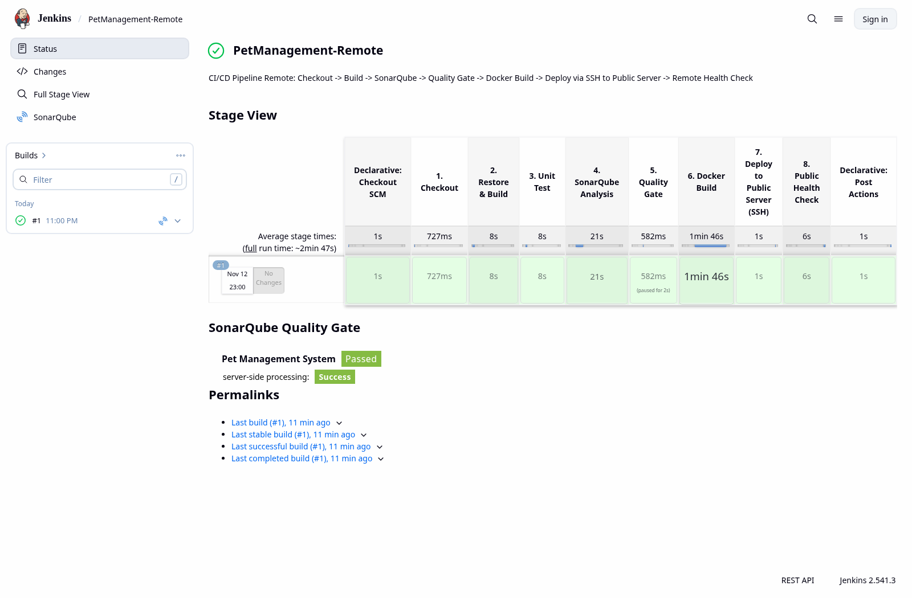

*Hình 6.6: Kết quả thực thi Pipeline thứ hai (PetManagement-Remote) hoàn tất triển khai tự động qua SSH và kiểm tra Public Health Check.*

---

## CHƯƠNG 7: TRIỂN KHAI VÀ GIÁM SÁT HỆ THỐNG VỚI PROMETHEUS VÀ GRAFANA

### 7.1. Kiến trúc Giám sát Đa tầng (Observability Architecture)

Để giám sát toàn diện sức khỏe và hiệu năng của hệ thống sau khi triển khai, cụm docker-compose.monitoring.yml thiết lập kiến trúc thu thập chỉ số (Metrics) ở cả 3 tầng:

- Tầng Ứng dụng (.NET 8 Web API): Thư viện prometheus-net.AspNetCore được gắn vào pipeline xử lý HTTP của ứng dụng trong Program.cs thông qua hai lệnh app.UseHttpMetrics() và app.MapMetrics(), xuất dữ liệu chuẩn OpenMetrics tại đường dẫn http://petmanagement_webapp:80/metrics.
- Tầng Container (Docker Runtime): Dịch vụ Google cAdvisor (petmanagement_cadvisor) thu thập mức tiêu thụ CPU, bộ nhớ RAM, lưu lượng mạng thu/phát và I/O ổ đĩa của từng container trong thời gian thực.
- Tầng Máy chủ Vật lý / Máy ảo (Host OS): Dịch vụ Prometheus Node Exporter (petmanagement_node_exporter) thu thập các chỉ số phần cứng và hệ điều hành của máy chủ chạy Docker.

### 7.2. Cấu hình Prometheus Scraping & Xác nhận Trạng thái Targets

Tệp cấu hình monitoring/prometheus/prometheus.yml định nghĩa chu kỳ thu thập dữ liệu (scrape_interval) là 15 giây (riêng đối với ứng dụng chính petmanagement_webapp là 10 giây). Trên giao diện quản lý của Prometheus tại http://localhost:9091/targets, cả 4/4 điểm thu thập (Targets) bao gồm cadvisor, node_exporter, petmanagement_webapp và prometheus đều đạt trạng thái UP (100% Healthy) với thời gian phản hồi chỉ vài mili-giây:

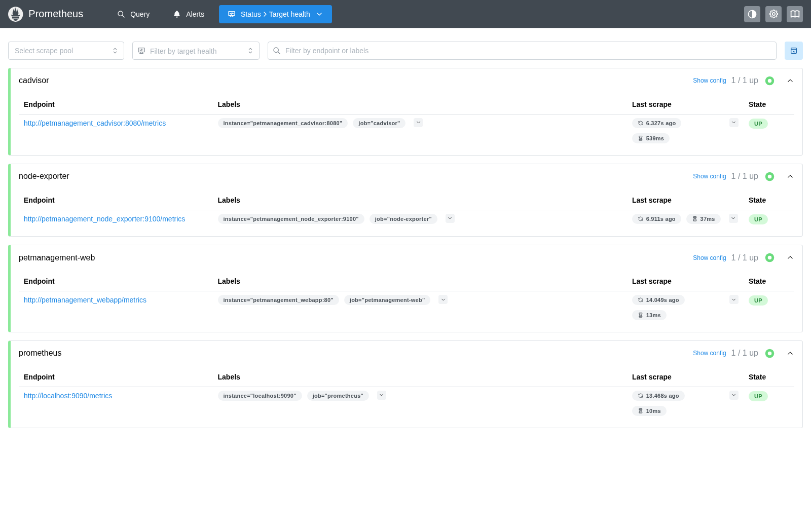

*Hình 7.1: Giao diện Prometheus Status -> Targets tại http://localhost:9091/targets xác nhận cả 4/4 mục tiêu giám sát đều ở trạng thái UP.*

### 7.3. Thiết kế Bảng điều khiển Grafana Auto-Provisioning (8 Biểu đồ)

Grafana (http://localhost:3001) được cấu hình cơ chế Auto-Provisioning trong thư mục monitoring/grafana/provisioning/: tự động kết nối nguồn dữ liệu (Datasource) tới http://prometheus:9090 và nạp sẵn bảng điều khiển 'PetManagement - System & Application Monitoring' gồm 8 biểu đồ chuyên sâu mà không cần thao tác cấu hình thủ công:

- Nhóm chỉ số trạng thái nhanh (Stat Panels): (1) Trạng thái Ứng dụng PetManagement (UP/DOWN); (2) Tổng số HTTP Requests ứng dụng đã phục vụ; (3) Số lượng Containers đang hoạt động trên hệ thống; (4) Mức tiêu thụ RAM hiện tại của tiến trình .NET 8.
- Nhóm biểu đồ chuỗi thời gian (Time-Series Panels): (5) Tốc độ HTTP Request/s phân tách theo từng mã phản hồi (2xx, 4xx, 5xx) và phương thức (GET, POST, PUT, DELETE); (6) Độ trễ xử lý HTTP Request phân vị thứ 95 (P95 Latency) theo từng Controller; (7) Mức sử dụng CPU của ứng dụng và toàn hệ thống; (8) Băng thông mạng Nhận/Gửi (Network I/O) theo thời gian thực.

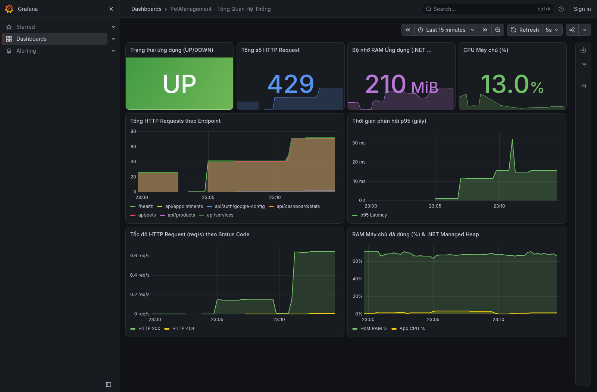

*Hình 7.2: Giao diện Grafana Dashboard tại http://localhost:3001 hiển thị trực quan 8 biểu đồ giám sát thời gian thực của hệ thống PetManagement.*

---

## CHƯƠNG 8: TỔNG KẾT, ĐÁNH GIÁ KẾT QUẢ VÀ HƯỚNG PHÁT TRIỂN

### 8.1. Tổng kết các kết quả đạt được

Qua quá trình phân tích, thiết kế, lập trình và tích hợp hạ tầng DevOps, dự án Hệ thống Quản lý & Chăm sóc Thú cưng (PetCare Hub) đã hoàn thành vượt mức các mục tiêu đề ra. Bảng dưới đây tổng hợp sự thay đổi và nâng cấp toàn diện của hệ thống hiện tại so với phiên bản cơ sở ban đầu:

| Hạng mục đánh giá | Phiên bản cơ sở ban đầu | Phiên bản hoàn thiện hiện tại (Tích hợp CI/CD & Monitoring) |
| --- | --- | --- |
| Cơ sở dữ liệu | Chỉ dùng In-Memory Database, mất dữ liệu khi tắt ứng dụng. | Kết nối Microsoft SQL Server 2022 chạy trong Docker có volume lưu trữ bền vững, kèm cơ chế Auto-Fallback 3 giây sang In-Memory khi chạy độc lập. |
| Cấu trúc bảng & Thanh toán | Thanh toán chỉ xóa giỏ hàng ở Client, chưa trừ tồn kho và chưa lưu đơn hàng. | Bổ sung bảng ProductOrders và API POST /api/products/checkout kiểm tra số lượng tồn kho, trừ StockQuantity thực tế và cộng dồn vào doanh thu Dashboard. |
| Quản lý Hồ sơ Thú cưng | Gặp lỗi khóa ngoại OwnerId trên SQL Server và thiếu nút xóa trực tiếp ngoài thẻ thú cưng. | Tự động đồng bộ phiên người dùng (POST /api/auth/sync), bật IgnoreCycles, bổ sung nút Xóa trên từng thẻ Card, trong Modal Sửa và nút Xóa hàng loạt Pet mới nhập. |
| Kiểm thử & Chất lượng code | Kiểm thử thủ công, chưa có báo cáo độ phủ mã nguồn. | Tích hợp 16 bài kiểm thử tự động xUnit + Coverlet OpenCover, phân tích qua SonarQube đạt Quality Gate: PASSED (Coverage 75.2%, 0 Bugs, 0 Vulnerabilities). |
| Đóng gói & Triển khai | Đóng gói đơn lẻ 1 container web, triển khai thủ công. | Quy hoạch 9 containers trên 3 cụm Docker Compose. Tự động hóa hoàn toàn qua 2 Jenkins Pipelines: PetManagement-Local và PetManagement-Remote (Deploy qua SSH). |
| Giám sát vận hành | Chưa có công cụ theo dõi sức khỏe và tài nguyên hệ thống. | Tích hợp prometheus-net (/metrics, /health), Prometheus (4/4 UP targets), cAdvisor, Node Exporter và Grafana Dashboard 8 biểu đồ thời gian thực. |

### 8.2. Những hạn chế còn tồn tại

- Thanh toán trực tuyến hiện mới dừng ở mức ghi nhận phương thức COD và mô phỏng chuyển khoản ngân hàng/QR Code, chưa kết nối webhook đối soát tự động với cổng thanh toán ngân hàng thực tế (VNPay, MoMo).
- Hệ thống chưa tích hợp dịch vụ gửi thông báo đẩy (Push Notification) hoặc gửi Email tự động (SMTP/SendGrid) tới hộp thư của khách hàng khi Quản trị viên chuyển trạng thái lịch hẹn sang Confirmed.

### 8.3. Hướng phát triển trong tương lai

- 1. Tích hợp Cổng thanh toán & Hóa đơn điện tử: Kết nối API thanh toán trực tuyến VNPay / VietQR động kèm webhook tự động xác nhận trạng thái thanh toán đơn hàng.
- 2. Hệ thống Thông báo Thời gian thực (SignalR & Email/SMS): Tích hợp ASP.NET Core SignalR để đẩy thông báo tức thì lên màn hình Admin khi có lịch hẹn mới và gửi Email nhắc lịch tiêm phòng định kỳ cho chủ thú cưng.
- 3. Mở rộng Hạ tầng CI/CD & Cảnh báo Giám sát (Alertmanager): Tích hợp Prometheus Alertmanager và Grafana Alerting gửi cảnh báo trực tiếp qua Telegram / Slack khi độ trễ API vượt ngưỡng hoặc khi container dừng đột ngột, đồng thời hướng tới triển khai trên cụm Kubernetes (K8s) với khả năng tự động mở rộng (Horizontal Pod Autoscaler).