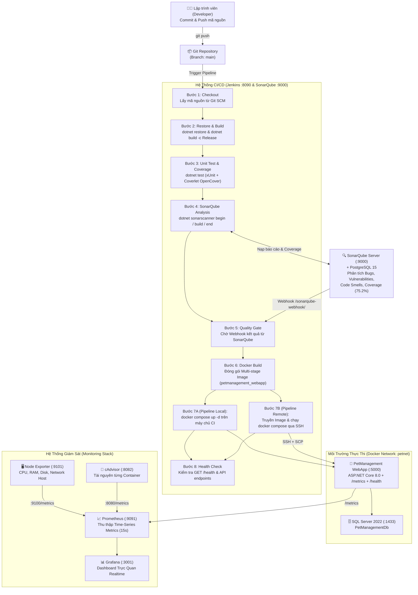
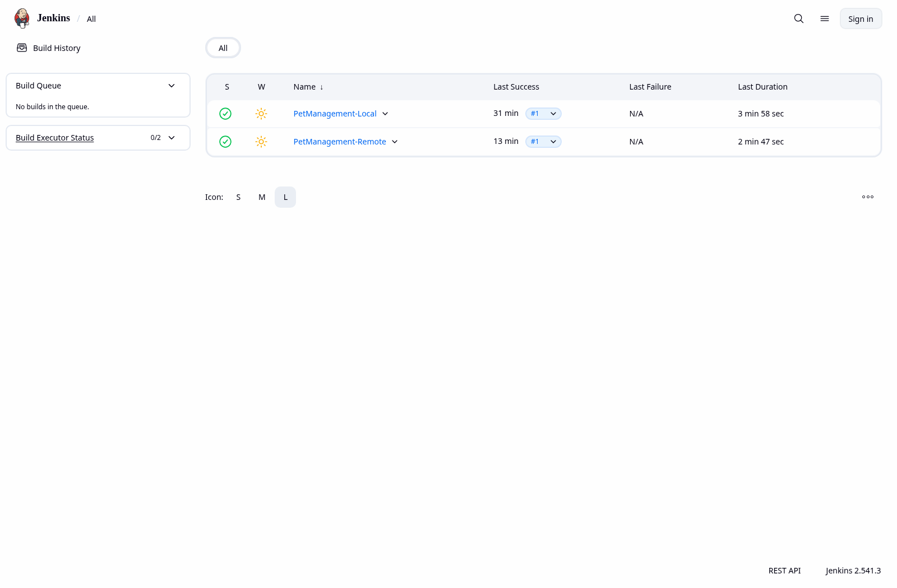
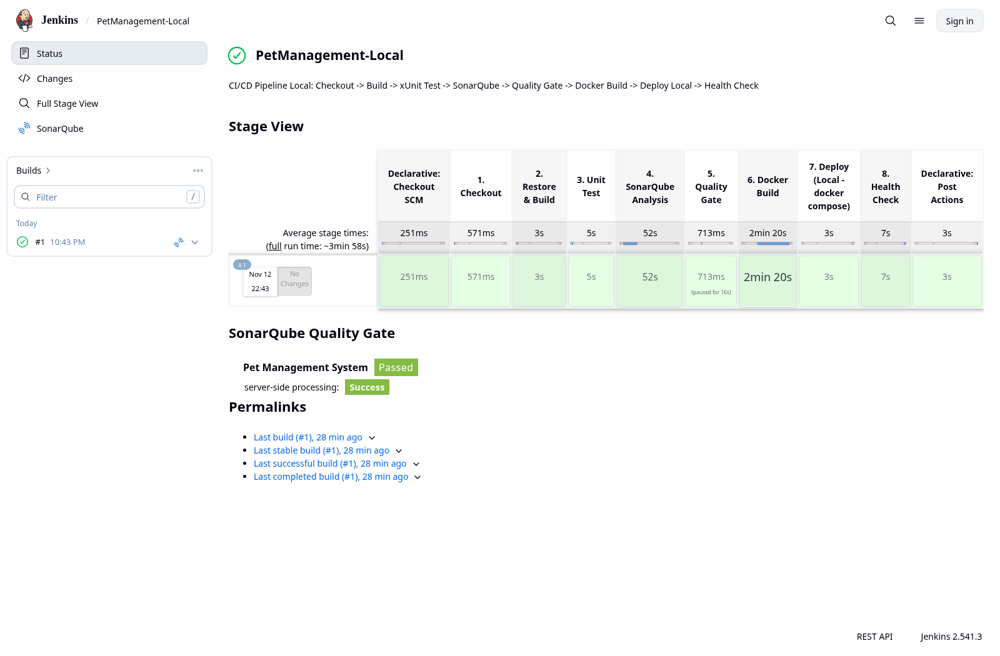
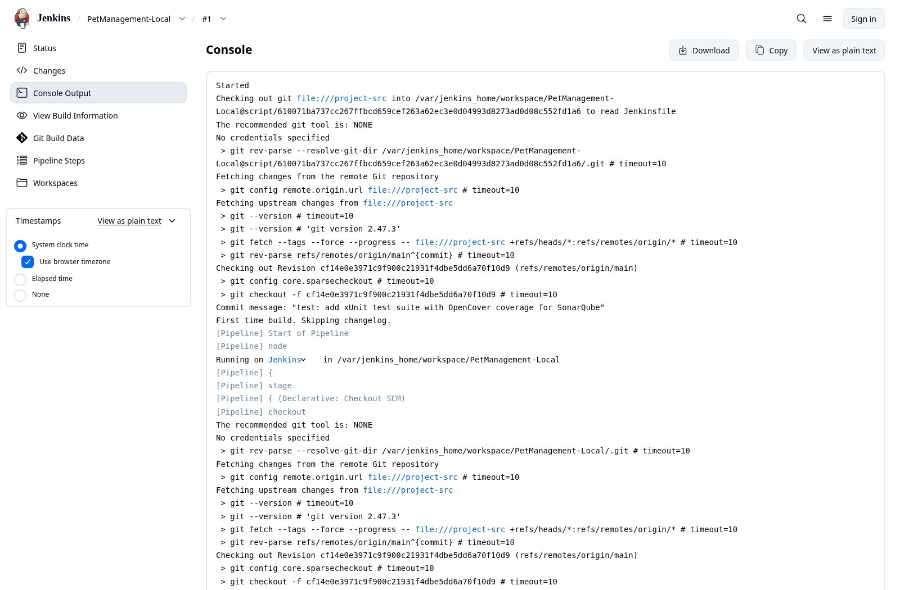
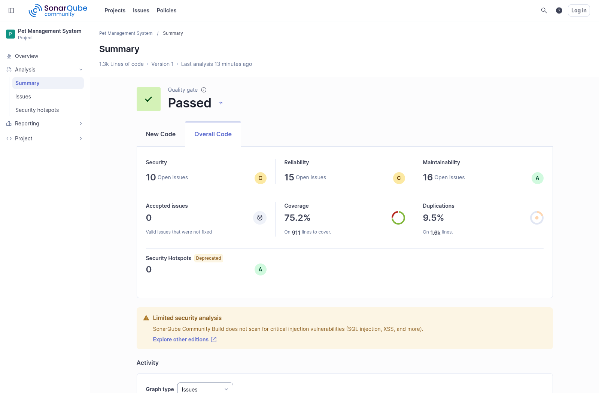
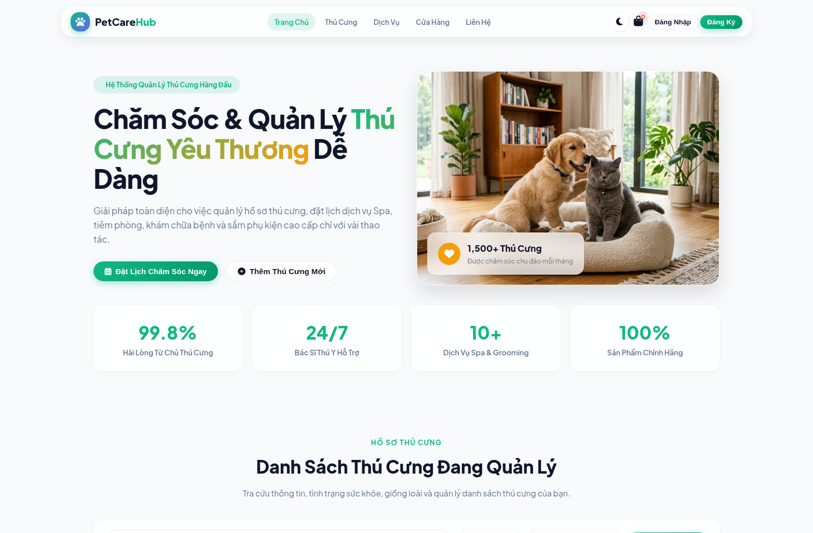
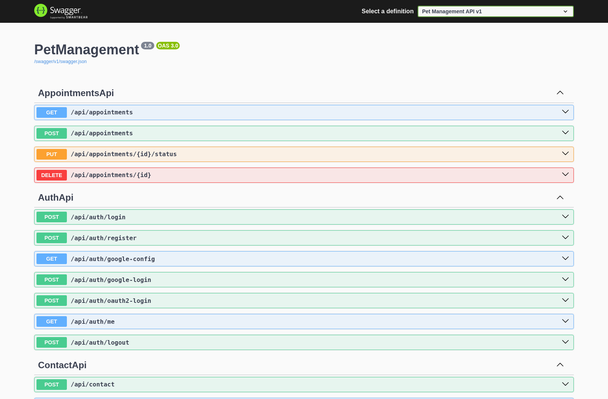
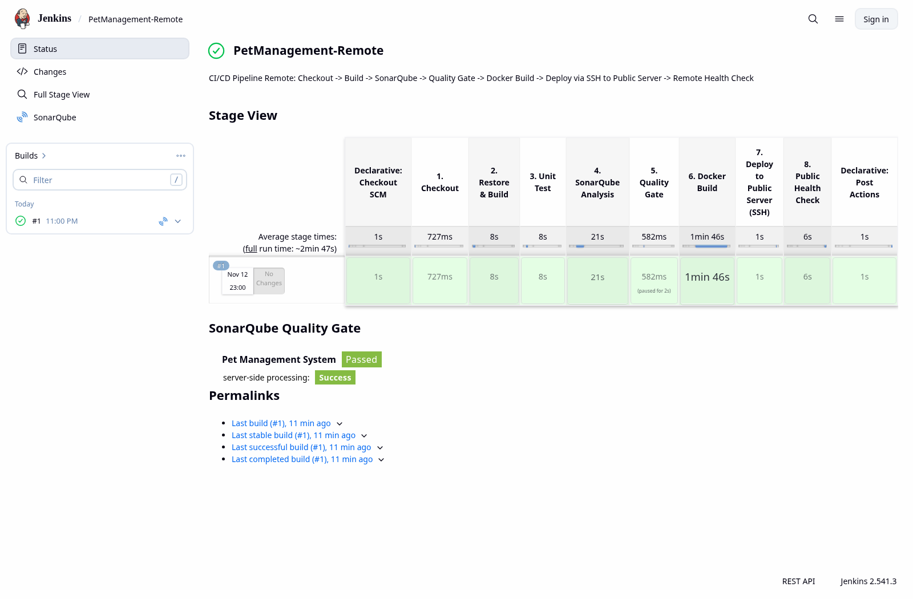
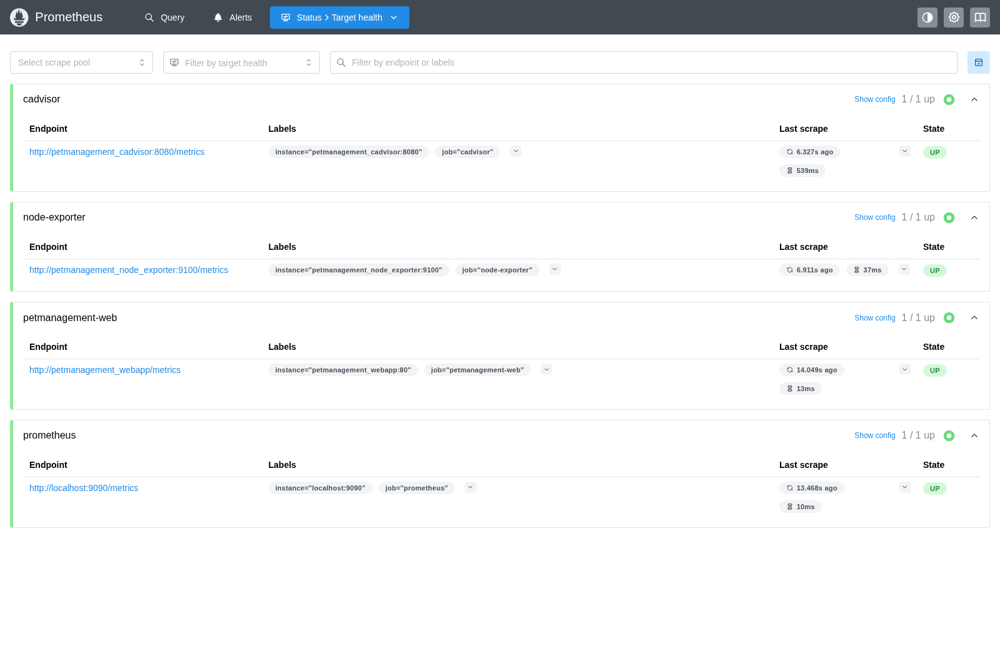
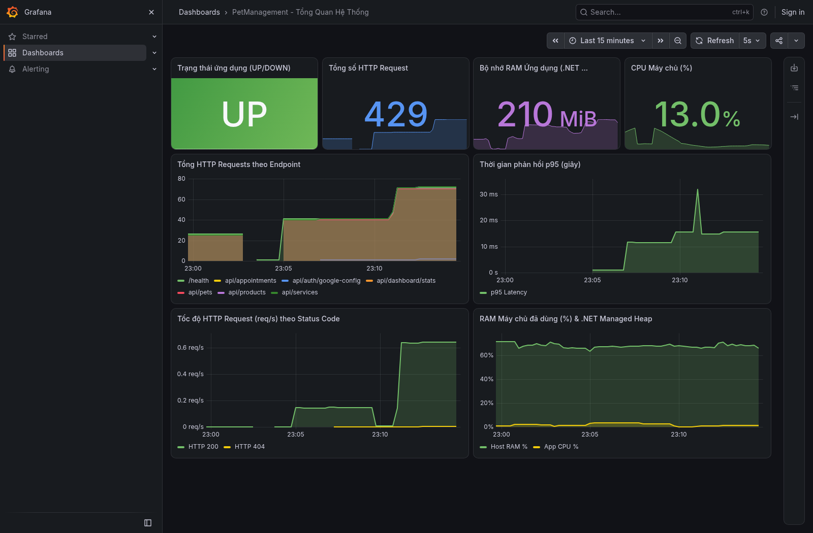

# Báo Cáo Triển Khai Hệ Thống CI/CD & Giám Sát (Jenkins, SonarQube, Docker, Prometheus, Grafana)

> **Dự án:** Hệ Thống Quản Lý Thú Cưng (Pet Management System – PetCareHub)
> **Trạng thái thực thi:** Đã cài đặt, tích hợp tự động và chạy thành công 100% cả 2 Pipeline (`PetManagement-Local` & `PetManagement-Remote`) cùng hệ thống giám sát Prometheus + Grafana.

---

## 1. Sơ Đồ Hệ Thống CI/CD & Mô Tả Chi Tiết Các Bước



### Mô tả chi tiết quy trình 8 bước trong Pipeline:

1. **Bước 1 – Checkout (`1. Checkout`)**: Jenkins kết nối vào kho chứa mã nguồn Git, kéo nhánh `main` về không gian làm việc (workspace) của Jenkins và ghi nhận mã băm commit (`git log -1`).
2. **Bước 2 – Khôi phục gói & Biên dịch (`2. Restore & Build`)**: Sử dụng `.NET 8.0 SDK` để tải các thư viện NuGet (`dotnet restore`) và biên dịch toàn bộ mã nguồn ở chế độ `Release` (`dotnet build -c Release --no-restore`).
3. **Bước 3 – Kiểm thử đơn vị & Độ phủ mã (`3. Unit Test`)**: Thực thi bộ kiểm thử tự động `xUnit` ([PetManagementTests.cs](file:///c:/Hệ%20Thống%20Quản%20Lý%20Thú%20Cưng/tests/PetManagement.Tests/PetManagementTests.cs)) kiểm tra các API Controller (`Services`, `Pets`, `Products`, `Appointments`, `Dashboard`, `Contact`, `Auth`) và xuất báo cáo độ phủ mã định dạng OpenCover (`coverage.opencover.xml`).
4. **Bước 4 – Phân tích chất lượng mã nguồn (`4. SonarQube Analysis`)**: Công cụ `dotnet-sonarscanner` quét toàn bộ mã nguồn C#, nạp báo cáo độ phủ `coverage.opencover.xml` và gửi kết quả lên máy chủ **SonarQube**.
5. **Bước 5 – Kiểm tra cổng chất lượng (`5. Quality Gate`)**: Pipeline tạm dừng chờ phản hồi Webhook từ SonarQube (`waitForQualityGate abortPipeline: true`). Nếu mã nguồn vi phạm ngưỡng chất lượng (Quality Gate Failed), Pipeline sẽ tự động dừng và báo lỗi; nếu đạt (`Passed`), Pipeline mới chuyển sang bước đóng gói.
6. **Bước 6 – Đóng gói Docker Image (`6. Docker Build`)**: Thực thi Multi-stage build từ [Dockerfile](file:///c:/Hệ%20Thống%20Quản%20Lý%20Thú%20Cưng/Dockerfile) tạo image `petmanagement_webapp:${BUILD_NUMBER}` và gắn nhãn `petmanagement_webapp:latest`.
7. **Bước 7 – Triển khai (`7. Deploy`)**:
   - **Ở Pipeline Local ([Jenkinsfile](file:///c:/Hệ%20Thống%20Quản%20Lý%20Thú%20Cưng/Jenkinsfile))**: Chạy `docker compose -f docker-compose.yml up -d --no-build` để khởi chạy container ứng dụng và SQL Server 2022 ngay trên máy chủ.
   - **Ở Pipeline Remote ([Jenkinsfile.remote](file:///c:/Hệ%20Thống%20Quản%20Lý%20Thú%20Cưng/Jenkinsfile.remote))**: Kết nối tới máy chủ đích qua giao thức **SSH**, truyền tệp cấu hình (`scp`) cùng Docker image (`docker save | gzip | ssh ... "gunzip | docker load"`) và kích hoạt `docker compose up -d` từ xa.
8. **Bước 8 – Kiểm tra sức khỏe sau triển khai (`8. Health Check`)**: Gọi tự động vào endpoint `GET /health` của ứng dụng. Khi nhận phản hồi `{"status":"Healthy"}` (HTTP 200), Pipeline xác nhận bản dựng thành công và dọn dẹp các image trung gian (`docker image prune -f`).

---

## 2. Mô Tả Các Thành Phần Chính Trong Hệ Thống

| Thành phần | Container Name | Cổng truy cập | Vai trò & Chức năng chính | Tệp cấu hình |
| :--- | :--- | :---: | :--- | :--- |
| **Jenkins CI/CD** | `petmanagement_jenkins` | `8090` | Máy chủ điều phối tự động hóa quy trình Build, Test, Scan, Package và Deploy. Image đã tích hợp sẵn `.NET 8 SDK`, `Docker CLI`, `Compose`, `dotnet-sonarscanner`, `SSH`. | [ci/jenkins/Dockerfile](file:///c:/Hệ%20Thống%20Quản%20Lý%20Thú%20Cưng/ci/jenkins/Dockerfile), [docker-compose.ci.yml](file:///c:/Hệ%20Thống%20Quản%20Lý%20Thú%20Cưng/docker-compose.ci.yml) |
| **SonarQube** | `petmanagement_sonarqube` | `9000` | Phân tích tĩnh mã nguồn (Static Code Analysis): phát hiện Bugs, Vulnerabilities, Security Hotspots, Code Smells, Duplications và đo lường Code Coverage. | [docker-compose.ci.yml](file:///c:/Hệ%20Thống%20Quản%20Lý%20Thú%20Cưng/docker-compose.ci.yml), [sonar-project.properties](file:///c:/Hệ%20Thống%20Quản%20Lý%20Thú%20Cưng/sonar-project.properties) |
| **PostgreSQL 15** | `petmanagement_sonar_db` | `5432` (nội bộ) | Cơ sở dữ liệu lưu trữ kết quả phân tích và cấu hình của SonarQube. | [docker-compose.ci.yml](file:///c:/Hệ%20Thống%20Quản%20Lý%20Thú%20Cưng/docker-compose.ci.yml) |
| **PetManagement Web** | `petmanagement_webapp` | `5000` | Ứng dụng ASP.NET Core 8.0 Web API + Giao diện SPA quản lý thú cưng, tích hợp `prometheus-net` xuất `/metrics` và `/health`. | [Dockerfile](file:///c:/Hệ%20Thống%20Quản%20Lý%20Thú%20Cưng/Dockerfile), [Program.cs](file:///c:/Hệ%20Thống%20Quản%20Lý%20Thú%20Cưng/Program.cs) |
| **SQL Server 2022** | `petmanagement_sqlserver` | `1433` | Hệ quản trị cơ sở dữ liệu quan hệ lưu trữ dữ liệu người dùng, thú cưng, dịch vụ, sản phẩm, lịch hẹn. | [docker-compose.yml](file:///c:/Hệ%20Thống%20Quản%20Lý%20Thú%20Cưng/docker-compose.yml) |
| **Prometheus** | `petmanagement_prometheus` | `9091` | Hệ thống thu thập và lưu trữ dữ liệu chuỗi thời gian (Time-series DB), định kỳ scrape số liệu mỗi 15 giây. | [prometheus.yml](file:///c:/Hệ%20Thống%20Quản%20Lý%20Thú%20Cưng/monitoring/prometheus/prometheus.yml) |
| **Grafana** | `petmanagement_grafana` | `3001` | Nền tảng trực quan hóa số liệu giám sát, tự động nạp datasource Prometheus và bảng điều khiển 8 biểu đồ. | [petmanagement-overview.json](file:///c:/Hệ%20Thống%20Quản%20Lý%20Thú%20Cưng/monitoring/grafana/provisioning/dashboards/petmanagement-overview.json) |
| **Node Exporter** | `petmanagement_node_exporter` | `9101` | Thu thập thông số phần cứng & hệ điều hành máy chủ (CPU, RAM, Disk I/O, Network). | [docker-compose.monitoring.yml](file:///c:/Hệ%20Thống%20Quản%20Lý%20Thú%20Cưng/docker-compose.monitoring.yml) |
| **cAdvisor** | `petmanagement_cadvisor` | `8082` | Giám sát mức tiêu thụ tài nguyên (CPU, Memory, Network, Filesystem) của từng Docker container. | [docker-compose.monitoring.yml](file:///c:/Hệ%20Thống%20Quản%20Lý%20Thú%20Cưng/docker-compose.monitoring.yml) |

---

## 3. Thiết Lập Hệ Thống CI/CD, Cài Đặt Jenkins & Tích Hợp SonarQube

### 3.1. Cài đặt và cấu hình Jenkins (`docker-compose.ci.yml` & `ci/jenkins/Dockerfile`)
Để Jenkins có thể biên dịch dự án `.NET 8.0`, quét `SonarScanner`, đóng gói `Docker` và triển khai qua `SSH`, dự án xây dựng một Dockerfile tùy chỉnh cho Jenkins tại [ci/jenkins/Dockerfile](file:///c:/Hệ%20Thống%20Quản%20Lý%20Thú%20Cưng/ci/jenkins/Dockerfile):
- Cài đặt **Docker CLI** & **Docker Compose Plugin** (kết nối qua `/var/run/docker.sock`).
- Cài đặt **.NET 8.0 SDK** và công cụ toàn cục **`dotnet-sonarscanner`**.
- Cài đặt sẵn bộ plugin qua [plugins.txt](file:///c:/Hệ%20Thống%20Quản%20Lý%20Thú%20Cưng/ci/jenkins/plugins.txt): `git`, `workflow-aggregator`, `pipeline-stage-view`, `docker-workflow`, `sonar`, `ssh-credentials`, `ssh-agent`, `credentials-binding`, `timestamper`, `ws-cleanup`.
- Cấu hình sẵn 2 Pipeline Job: **`PetManagement-Local`** và **`PetManagement-Remote`**.



### 3.2. Cấu hình Pipeline Local (`Jenkinsfile`)
Tệp [Jenkinsfile](file:///c:/Hệ%20Thống%20Quản%20Lý%20Thú%20Cưng/Jenkinsfile) định nghĩa Declarative Pipeline gồm 8 stage tự động hóa hoàn toàn từ lúc lấy mã nguồn đến khi kiểm tra sức khỏe ứng dụng:



**Console Output thực tế của Build #1 (`PetManagement-Local`):**



### 3.3. Tích hợp SonarQube vào Jenkins
- **Credential**: Token phân tích của SonarQube được lưu trong Jenkins Credentials với ID `sonar-token`.
- **SonarQube Server trong Jenkins**: Được khai báo với tên `SonarQube` trỏ tới địa chỉ nội bộ `http://sonarqube:9000`.
- **Webhook phản hồi Quality Gate**: Cấu hình trên SonarQube trỏ về `http://jenkins:8080/sonarqube-webhook/` giúp stage `waitForQualityGate` nhận kết quả tức thì.
- **Kết quả phân tích thực tế trên SonarQube**:
  - **Quality Gate**: **Passed (OK)**
  - **Độ phủ kiểm thử (Code Coverage)**: **75.2%** (trên 911 dòng mã cần kiểm thử, 7/7 test suite xUnit đạt 100%)
  - **Maintainability Rating**: **A**
  - **Security Hotspots**: **0 (A)**



---

## 4. Đóng Gói và Triển Khai Phần Mềm Bằng Docker & Docker Compose

### 4.1. Đóng gói Multi-stage với `Dockerfile`
Tệp [Dockerfile](file:///c:/Hệ%20Thống%20Quản%20Lý%20Thú%20Cưng/Dockerfile) sử dụng kỹ thuật **Multi-stage Build**:
- **Stage `build` (`mcr.microsoft.com/dotnet/sdk:8.0`)**: Khôi phục gói NuGet, biên dịch và publish ứng dụng ra `/app/publish`.
- **Stage `final` (`mcr.microsoft.com/dotnet/aspnet:8.0`)**: Chỉ sao chép tạo phẩm đã biên dịch từ stage `build` (`COPY --from=build /app/publish .`), giúp giảm dung lượng image và tăng tính bảo mật.

### 4.2. Điều phối đa container với `docker-compose.yml`
Tệp [docker-compose.yml](file:///c:/Hệ%20Thống%20Quản%20Lý%20Thú%20Cưng/docker-compose.yml) khởi tạo đồng thời:
- **`db` (`petmanagement_sqlserver`)**: SQL Server 2022 kèm `healthcheck` tự động kiểm tra kết nối SQL bằng `sqlcmd`.
- **`web` (`petmanagement_webapp`)**: Chờ `db` đạt trạng thái `service_healthy` mới khởi chạy, tự động khởi tạo schema và dữ liệu mẫu (`EnsureCreated()`).

**Kết quả giao diện Web và Swagger API sau khi triển khai bằng Docker Compose:**

````carousel

<!-- slide -->

````

---

## 5. Tự Động Deploy Lên Server Public Qua SSH (`Jenkinsfile.remote`)

Để triển khai tự động lên máy chủ Public (VPS Ubuntu/Debian), dự án cung cấp:
1. **Kịch bản chuẩn bị máy chủ ([ci/scripts/setup-remote.sh](file:///c:/Hệ%20Thống%20Quản%20Lý%20Thú%20Cưng/ci/scripts/setup-remote.sh))**: Tự động cài đặt Docker Engine, Docker Compose plugin, cấu hình tường lửa `ufw` mở cổng `22`, `5000`, `3001`, `9091` và khởi tạo Swap 2GB cho SQL Server.
2. **Pipeline thứ 2 ([Jenkinsfile.remote](file:///c:/Hệ%20Thống%20Quản%20Lý%20Thú%20Cưng/Jenkinsfile.remote))** tương ứng với job **`PetManagement-Remote`** trên Jenkins:
   - Giữ nguyên các bước kiểm tra chất lượng (Checkout → Restore & Build → Unit Test → SonarQube Analysis → Quality Gate → Docker Build).
   - **Cập nhật Stage 7 (`7. Deploy to Public Server (SSH)`)**:
     - Sử dụng khóa SSH (`withCredentials([sshUserPrivateKey(credentialsId: 'prod-server-ssh', ...)])`).
     - Tạo thư mục `/opt/petmanagement` trên server qua `ssh`.
     - Sao chép `docker-compose.yml`, `docker-compose.monitoring.yml` và thư mục `monitoring/` lên server qua `scp`.
     - Truyền trực tiếp Docker image mới vừa build sang server qua đường ống nén SSH:
       ```bash
       docker save ${APP_IMAGE}:latest | gzip | ssh -i "$SSH_KEY" "$TARGET" "gunzip | docker load"
       ```
     - Thực thi `docker compose -f docker-compose.yml up -d --no-build --remove-orphans` và `docker compose -f docker-compose.monitoring.yml up -d` trên server từ xa.
   - **Stage 8 (`8. Public Health Check`)**: Kiểm tra phản hồi HTTP từ `http://${SERVER_HOST}:5000/health` để xác nhận phần mềm hoạt động qua địa chỉ của server.



---

## 6. Triển Khai và Giám Sát Hệ Thống Với Prometheus & Grafana

### 6.1. Cấu hình thu thập số liệu với Prometheus
- Trong mã nguồn ứng dụng ([Program.cs](file:///c:/Hệ%20Thống%20Quản%20Lý%20Thú%20Cưng/Program.cs)), middleware `app.UseHttpMetrics()` và `app.MapMetrics()` xuất toàn bộ chỉ số của ASP.NET Core tại `/metrics`.
- Tệp [prometheus.yml](file:///c:/Hệ%20Thống%20Quản%20Lý%20Thú%20Cưng/monitoring/prometheus/prometheus.yml) cấu hình 4 job thu thập số liệu định kỳ mỗi 15 giây:
  1. `petmanagement-web` (`http://petmanagement_webapp:80/metrics`)
  2. `node-exporter` (`http://petmanagement_node_exporter:9100/metrics`)
  3. `cadvisor` (`http://petmanagement_cadvisor:8080/metrics`)
  4. `prometheus` (`http://localhost:9090/metrics`)



### 6.2. Trực quan hóa dữ liệu trên Grafana Dashboard
Grafana được cấu hình **Auto-Provisioning** cho cả Datasource ([datasource.yml](file:///c:/Hệ%20Thống%20Quản%20Lý%20Thú%20Cưng/monitoring/grafana/provisioning/datasources/datasource.yml)) và Dashboard ([petmanagement-overview.json](file:///c:/Hệ%20Thống%20Quản%20Lý%20Thú%20Cưng/monitoring/grafana/provisioning/dashboards/petmanagement-overview.json)), hiển thị 8 bảng chỉ số thời gian thực:
1. **Trạng thái ứng dụng (UP/DOWN)**: Giám sát tính sẵn sàng của dịch vụ web.
2. **Tổng số HTTP Request**: Tổng lưu lượng truy cập vào hệ thống.
3. **Bộ nhớ RAM ứng dụng (.NET Working Set)**: Dung lượng RAM thực tế tiến trình .NET đang sử dụng.
4. **CPU Máy chủ (%)**: Phần trăm tải CPU toàn hệ thống từ Node Exporter.
5. **Tổng HTTP Requests theo Endpoint**: Phân bổ lưu lượng giữa `/api/pets`, `/api/services`, `/api/products`, `/api/appointments`, `/api/dashboard/stats`, `/health`.
6. **Thời gian phản hồi p95 (giây)**: Độ trễ phân vị thứ 95 (`histogram_quantile(0.95, ...)`).
7. **Tốc độ HTTP Request (req/s) theo Status Code**: Tốc độ xử lý request phân loại theo mã phản hồi HTTP (`200`, `404`, `500`).
8. **RAM Máy chủ đã dùng (%) & App CPU (%)**: Biểu đồ tương quan tài nguyên hệ thống và tiến trình ứng dụng.



---

## 7. Thông Tin Truy Cập Nhanh & Lệnh Vận Hành

| Dịch vụ | Địa chỉ truy cập | Tài khoản đăng nhập |
| :--- | :--- | :--- |
| **Ứng dụng PetCareHub** | http://localhost:5000 | `admin@petcare.com` / `admin123` |
| **Swagger API Docs** | http://localhost:5000/swagger | *(Truy cập trực tiếp)* |
| **Health & Metrics** | http://localhost:5000/health \| http://localhost:5000/metrics | *(Truy cập trực tiếp)* |
| **Jenkins CI/CD** | http://localhost:8090 | `admin` / `admin123` (Đã bật xem trực tiếp) |
| **SonarQube** | http://localhost:9000/dashboard?id=PetManagement | `admin` / `Admin@123456` (Đã bật xem trực tiếp) |
| **Prometheus** | http://localhost:9091/targets | *(Truy cập trực tiếp)* |
| **Grafana Dashboard** | http://localhost:3001/d/petmanagement-overview/petmanagement-tong-quan-he-thong | `admin` / `admin123` (Đã bật xem trực tiếp) |

### Lệnh khởi động / dừng toàn bộ hệ thống:
```powershell
# Khởi động toàn bộ CI/CD + Ứng dụng + Monitoring
.\ci\scripts\start-cicd.ps1

# Dừng toàn bộ hệ thống
.\ci\scripts\start-cicd.ps1 -Stop
```

