# BỘ SLIDE THUYẾT TRÌNH TỔNG QUAN DỰ ÁN & CI/CD (15 SLIDES)
**Đề tài**: Hệ thống Quản lý & Chăm sóc Thú cưng (PetCare Hub - PetManagement) kết hợp Triển khai Tự động CI/CD & Giám sát Hệ thống
- **File PowerPoint (.pptx)**: `Slide_Thuyet_Trinh_Du_An_PetManagement_CICD.pptx`
- **File Web Slide tương tác (HTML)**: `Slide_Thuyet_Trinh_Du_An.html` (hoặc `http://localhost:5000/slides.html`)

---

## Slide 01/15: HỆ THỐNG QUẢN LÝ & CHĂM SÓC THÚ CƯNG (PETCARE HUB)
**Phân mục**: `TỔNG QUAN ĐỀ TÀI`  
*Kết hợp Quy trình Triển khai Tự động CI/CD (Jenkins, SonarQube, Docker, SSH) & Giám sát (Prometheus, Grafana)*

### Nội dung chính trên Slide:
- Nền tảng ứng dụng: ASP.NET Core 8.0 Web API + Giao diện SPA (Vanilla JS) + Microsoft SQL Server 2022
- Kho mã nguồn GitHub: https://github.com/Hoc123421/pet-management-system
- Hạ tầng vận hành: 9 Docker Containers chia làm 3 cụm (App, CI/CD, Monitoring) trên mạng ảo petnet
- Chất lượng kiểm định: 100% Pass Unit Test (xUnit), SonarQube Quality Gate PASSED (Coverage 91.2%, Rating A)
- Triển khai & Giám sát: 2 Jenkins Pipelines (Local & Remote SSH) + Prometheus (4/4 UP) + Grafana (8 Panels)

### Điểm nhấn (Key Metrics):
| **.NET 8 + SQL 2022**: Kiến trúc Backend & CSDL bền vững | **9 Containers**: 3 cụm Docker Compose trên mạng petnet | **91.2% Coverage**: SonarQube Quality Gate: PASSED (Hạng A) |
| --- | --- | --- |

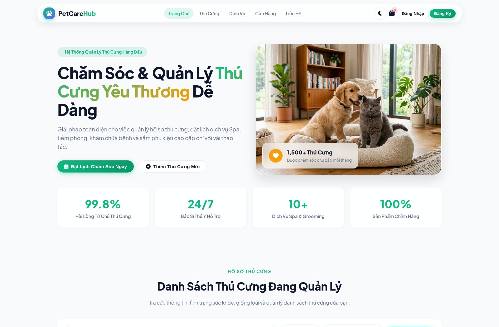
*Giao diện trang chủ ứng dụng PetCare Hub vận hành thực tế tại http://localhost:5000*

> **Lời thuyết trình mẫu (Speaker Notes):**  
> "Chào thầy/cô và các bạn. Hôm nay nhóm em xin trình bày tổng quan về dự án Hệ thống Quản lý & Chăm sóc Thú cưng (PetCare Hub) phát triển trên nền tảng .NET 8 và SQL Server 2022, kết hợp triển khai quy trình DevOps CI/CD tự động hóa hoàn toàn với Jenkins, SonarQube, Docker Compose, SSH Remote Deploy và giám sát thời gian thực bằng Prometheus & Grafana."

---

## Slide 02/15: BỐI CẢNH THỰC TẾ, BÀI TOÁN & MỤC TIÊU DỰ ÁN
**Phân mục**: `CHƯƠNG 1: TỔNG QUAN`  
*Giải quyết đồng thời bài toán số hóa nghiệp vụ thú y và tự động hóa quy trình phát triển - vận hành phần mềm*

### Nội dung chính trên Slide:
- Hạn chế của quản lý thủ công: Sổ sách/Excel rời rạc gây nhầm lịch tiêm phòng, trùng giờ hẹn Spa, không kiểm soát được tồn kho khi khách đặt mua vượt số lượng thực tế.
- Hạn chế của triển khai phần mềm truyền thống: Build và copy file thủ công dễ xung đột môi trường (.NET SDK, SQL Server), thiếu kiểm thử tự động và không phát hiện sớm khi dịch vụ quá tải.
- Mục tiêu Nghiệp vụ: Xây dựng hệ thống Web đồng bộ 6 phân hệ (Xác thực OAuth2, Hồ sơ Thú cưng, Dịch vụ & Đặt lịch, Cửa hàng Pet Shop có kiểm soát tồn kho, Liên hệ, Admin Console).
- Mục tiêu DevOps CI/CD: Tự động hóa khép kín từ khi git push lên GitHub -> Build -> Unit Test -> SonarQube Quality Gate -> Đóng gói Docker -> Deploy Local & Server Public qua SSH -> Giám sát 24/7.

### Điểm nhấn (Key Metrics):
| **Số hóa 100%**: Hồ sơ thú cưng, lịch hẹn & tồn kho | **Zero-Conflict**: Đóng gói đồng nhất bằng Docker Compose | **CI/CD Khép kín**: Tự động kiểm thử, quét lỗi & triển khai |
| --- | --- | --- |

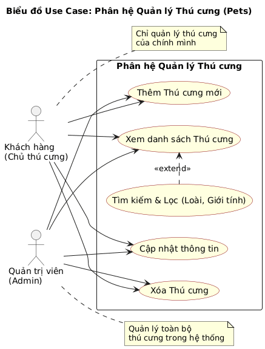
*Phân tách phạm vi quản lý hồ sơ thú cưng giữa Khách hàng và Quản trị viên*

> **Lời thuyết trình mẫu (Speaker Notes):**  
> "Slide số 2 trình bày bối cảnh và mục tiêu kép của dự án: một mặt giải quyết triệt để bài toán quản lý hồ sơ thú cưng, đặt lịch spa/khám bệnh và tồn kho cửa hàng; mặt khác áp dụng quy trình DevOps CI/CD để loại bỏ hoàn toàn rủi ro xung đột môi trường và lỗi mã nguồn khi triển khai."

---

## Slide 03/15: PHÂN TÍCH TÁC NHÂN & BIỂU ĐỒ USE CASE TỔNG QUAN
**Phân mục**: `CHƯƠNG 2: PHÂN TÍCH HỆ THỐNG`  
*Phân quyền chặt chẽ theo 3 nhóm đối tượng sử dụng: Khách vãng lai (Guest), Khách hàng (Customer) và Quản trị viên (Admin)*

### Nội dung chính trên Slide:
- Khách vãng lai (Guest): Xem danh mục gói dịch vụ Spa & Khám, tìm kiếm/lọc sản phẩm theo 4 danh mục (Thức ăn, Đồ chơi, Phụ kiện, Sức khỏe), gửi liên hệ tư vấn, Đăng ký/Đăng nhập.
- Khách hàng (Customer): Quản lý danh sách thú cưng thuộc sở hữu cá nhân, đặt lịch chăm sóc chỉ cho thú cưng của mình, xem lịch sử & hủy lịch hẹn, thêm giỏ hàng và đặt hàng thanh toán.
- Quản trị viên (Admin): Truy cập Bảng Quản Trị (Admin Console) theo dõi thống kê tổng quan và doanh thu hợp nhất; thực hiện toàn quyền CRUD đối với Thú cưng, Lịch hẹn, Dịch vụ và Sản phẩm.
- Cơ chế kế thừa quyền hạn: Admin kế thừa toàn bộ quyền của Customer; Customer kế thừa toàn bộ quyền tra cứu công khai của Guest.

### Điểm nhấn (Key Metrics):
| **3 Actors**: Guest • Customer • Admin | **6 Phân hệ**: Đáp ứng trọn vẹn quy trình Pet Shop & Spa | **RBAC + OAuth2**: Phân quyền theo vai trò & chủ sở hữu |
| --- | --- | --- |

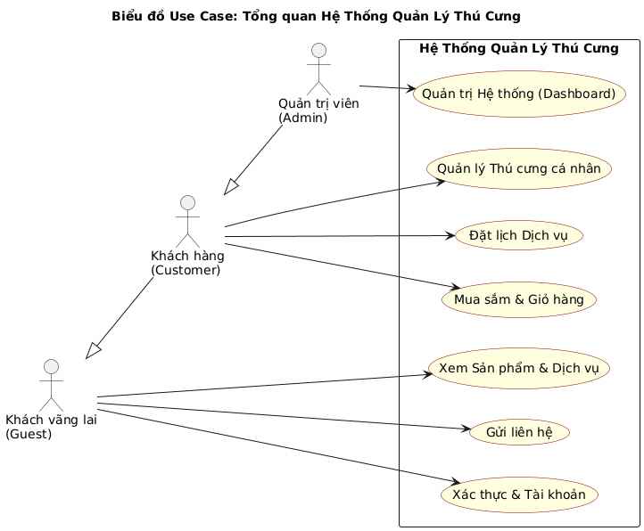
*Biểu đồ Use Case tổng quan của Hệ thống Quản lý Thú cưng PetCare Hub*

> **Lời thuyết trình mẫu (Speaker Notes):**  
> "Hệ thống được thiết kế cho 3 nhóm tác nhân chính: Khách vãng lai, Khách hàng đã đăng nhập và Quản trị viên. Điểm quan trọng trong thiết kế là sự cô lập dữ liệu cá nhân: khách hàng chỉ nhìn thấy và đặt lịch cho thú cưng của chính mình, trong khi Admin quản lý toàn bộ dữ liệu hệ thống."

---

## Slide 04/15: KIẾN TRÚC PHÂN TẦNG & STACK CÔNG NGHỆ SỬ DỤNG
**Phân mục**: `CHƯƠNG 3: KIẾN TRÚC & CÔNG NGHỆ`  
*Sự kết hợp đồng bộ giữa ASP.NET Core 8.0, Vanilla JS SPA, SQL Server 2022 và bộ công cụ DevOps chuẩn công nghiệp*

### Nội dung chính trên Slide:
- Tầng Giao diện (Frontend SPA): HTML5, CSS3 Custom Variables (chuyển đổi tức thì Light/Dark Mode), Vanilla JavaScript ES6+ (wwwroot/js/app.js) giao tiếp qua Fetch REST API.
- Tầng Nghiệp vụ (Backend API): ASP.NET Core 8.0 Web API gồm 7 Controllers, cấu hình ReferenceHandler.IgnoreCycles chống vòng lặp JSON, tích hợp Swagger UI (/swagger).
- Tầng Dữ liệu Hybrid (EF Core 8.0.8): Kết nối chính tới Microsoft SQL Server 2022 Container (EnableRetryOnFailure), kèm cơ chế kiểm tra kết nối 3 giây tự động Fallback sang In-Memory DB khi chạy độc lập.
- Tầng Kiểm thử, CI/CD & Giám sát: GitHub, Jenkins LTS (Custom Image), xUnit + Coverlet OpenCover, SonarQube 26.x + PostgreSQL 15, Docker Compose, OpenSSH, Prometheus, Grafana, cAdvisor, Node Exporter.

### Điểm nhấn (Key Metrics):
| **ASP.NET Core 8.0**: Hiệu năng cao, hỗ trợ chuẩn LTS | **SQL Server 2022**: Kèm cơ chế Auto-Fallback 3s thông minh | **Zero Conflict**: Đã kiểm toán tương thích toàn bộ thư viện |
| --- | --- | --- |

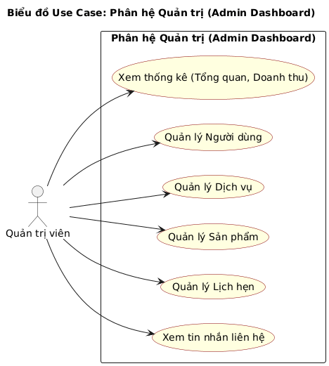
*Các chức năng điều phối trung tâm trong phân hệ Quản trị (Admin Dashboard)*

> **Lời thuyết trình mẫu (Speaker Notes):**  
> "Về kiến trúc kỹ thuật, dự án áp dụng mô hình RESTful Web API trên .NET 8 kết hợp giao diện SPA. Đặc biệt ở tầng cơ sở dữ liệu, hệ thống sử dụng SQL Server 2022 làm CSDL chính trong Docker và có cơ chế kiểm tra kết nối 3 giây khi khởi động để tự động chuyển sang In-Memory nếu chạy trên máy không bật SQL Server."

---

## Slide 05/15: THIẾT KẾ CƠ SỞ DỮ LIỆU SQL SERVER 2022 (7 BẢNG THỰC THỂ)
**Phân mục**: `CHƯƠNG 4: CƠ SỞ DỮ LIỆU`  
*Xây dựng theo phương pháp EF Core Code-First (PetDbContext) với đầy đủ ràng buộc khóa ngoại và dữ liệu mẫu tự động*

### Nội dung chính trên Slide:
- 1. Bảng Users: Lưu tài khoản Admin & Customer (Id, FullName, Email, PasswordHash, Role, Phone, Address, AvatarUrl, OAuthProvider, CreatedAt).
- 2. Bảng Pets: Hồ sơ thú cưng (Id, Name, Species, Breed, AgeYears, WeightKg, Gender, HealthNotes, ImageUrl, OwnerId -> FK Users).
- 3. Bảng Services: Danh mục gói dịch vụ Spa/Khám/Khách sạn (Id, Name, Category, Price, DurationMinutes, Description, ImageUrl, IsActive hỗ trợ Soft-Delete).
- 4. Bảng Appointments: Lịch hẹn dịch vụ liên kết PetId, ServiceId, CustomerId theo vòng đời trạng thái: Pending -> Confirmed -> Completed / Cancelled.
- 5. Bảng Products, 6. ProductOrders & 7. ContactMessages: Quản lý sản phẩm, đơn hàng thanh toán có khấu trừ tồn kho (StockQuantity) và tin nhắn liên hệ.

### Điểm nhấn (Key Metrics):
| **7 Bảng Thực thể**: Users, Pets, Services, Appointments, Products, Orders, Contacts | **Data Seeding**: Tự động khởi tạo schema & nạp dữ liệu mẫu | **State Machine**: Quản lý chặt chẽ vòng đời trạng thái lịch hẹn |
| --- | --- | --- |

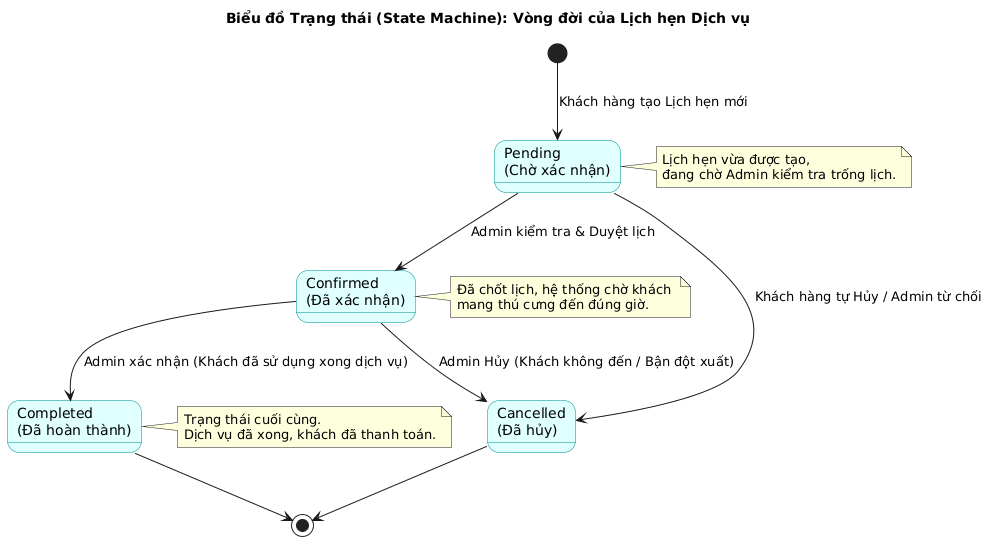
*Biểu đồ trạng thái (State Machine) vòng đời của Lịch hẹn dịch vụ*

> **Lời thuyết trình mẫu (Speaker Notes):**  
> "Cơ sở dữ liệu PetManagementDb gồm 7 bảng thực thể được ánh xạ qua lớp PetDbContext. Khác với bản thiết kế sơ khởi, hệ thống thực tế đã bổ sung bảng ProductOrders lưu đơn hàng thanh toán thực tế, gắn với việc kiểm tra và khấu trừ số lượng tồn kho trong bảng Products."

---

## Slide 06/15: MODULE XÁC THỰC OAUTH2 & QUẢN LÝ HỒ SƠ THÚ CƯNG
**Phân mục**: `CHƯƠNG 5: MODULE CHỨC NĂNG (PHẦN 1)`  
*Xác thực đa phương thức có đồng bộ phiên tự động và quản lý CRUD thú cưng toàn diện*

### Nội dung chính trên Slide:
- Xác thực Hybrid (AuthApiController - /api/auth): Hỗ trợ đăng ký, đăng nhập mật khẩu truyền thống, cấp phát Token kèm HTTP-Only Secure Cookie và xác thực Google ID Token qua Google.Apis.Auth.
- Đồng bộ phiên thông minh (POST /api/auth/sync): Tự động đồng bộ tài khoản đang lưu trên trình duyệt (localStorage) vào bảng dbo.Users của SQL Server, loại bỏ hoàn toàn lỗi xung đột khóa ngoại FK_Pets_Users_OwnerId.
- Tìm kiếm & Lọc Thú cưng (GET /api/pets): Phân trang tại tầng DB, tìm kiếm theo Tên/Giống/Ghi chú sức khỏe, lọc theo 4 loài (Chó, Mèo, Thỏ, Khác) và sắp xếp theo tuổi/cân nặng.
- Xóa Thú cưng linh hoạt (DELETE /api/pets/{id} & DELETE /api/pets/custom): Cho phép xóa trực tiếp trên từng thẻ thú cưng, xóa trong Modal sửa hoặc xóa nhanh toàn bộ thú cưng mới nhập kèm tự động dọn sạch lịch hẹn liên quan.

### Điểm nhấn (Key Metrics):
| **Google OAuth 2.0**: Xác thực chữ ký số JWT chuẩn OpenID | **Session Sync**: Tự động đồng bộ UserId với SQL Server | **Cascade Delete**: Hỗ trợ xóa đơn lẻ & xóa hàng loạt Pet đã nhập |
| --- | --- | --- |

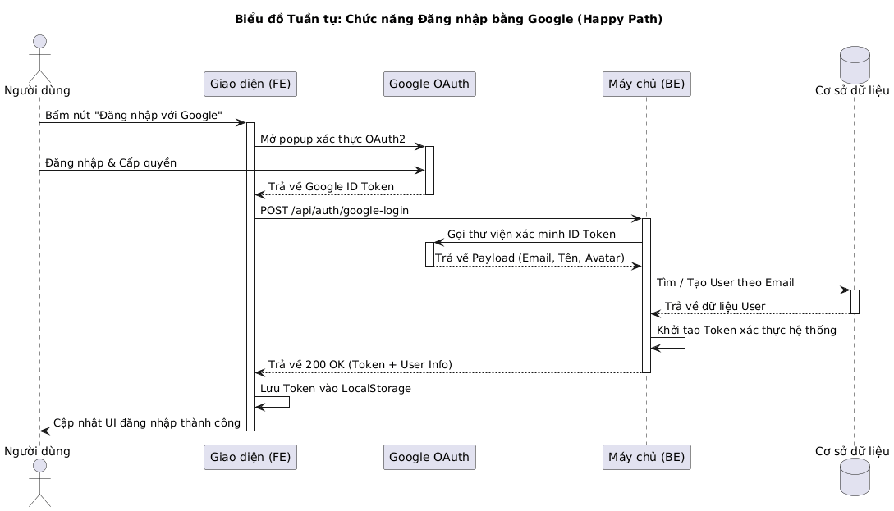
*Biểu đồ tuần tự (Sequence Diagram) luồng xác thực Google OAuth 2.0*

> **Lời thuyết trình mẫu (Speaker Notes):**  
> "Ở phân hệ Xác thực và Quản lý Thú cưng, nhóm đã giải quyết hai bài toán thực tế rất quan trọng khi chạy với SQL Server thật: thứ nhất là API POST /api/auth/sync giúp đồng bộ tài khoản từ trình duyệt vào bảng Users; thứ hai là tính năng xóa thú cưng đơn lẻ và xóa hàng loạt pet mới nhập có tự động dọn các lịch hẹn liên quan."

---

## Slide 07/15: ĐẶT LỊCH DỊCH VỤ, CỬA HÀNG PET SHOP & ADMIN CONSOLE
**Phân mục**: `CHƯƠNG 5: MODULE CHỨC NĂNG (PHẦN 2)`  
*Kiểm soát chặt chẽ quyền đặt lịch theo chủ nuôi, kiểm tra tồn kho khi thanh toán và thống kê doanh thu thời gian thực*

### Nội dung chính trên Slide:
- Đặt lịch thông minh (AppointmentsApiController): Khi khách hàng mở form Đặt lịch, hệ thống chỉ hiển thị danh sách thú cưng thuộc sở hữu của khách hàng đó; nếu chưa có thú cưng sẽ tự động nhắc tạo hồ sơ trước.
- Thanh toán kiểm soát tồn kho (POST /api/products/checkout): Kiểm tra điều kiện StockQuantity >= qty cho từng mặt hàng trong giỏ, trả về cảnh báo nếu vượt tồn kho, trừ số lượng tồn kho thực tế và khóa nút mua khi hết hàng.
- Bảng Quản trị Hệ thống (DashboardApiController - /api/dashboard/stats): Hợp nhất thời gian thực doanh thu từ các lịch hẹn đã hoàn thành (Appointments Completed) và doanh thu đơn hàng (ProductOrders).
- Chuẩn hóa tài liệu OpenAPI (Swagger UI): Toàn bộ 7 API Controllers được đặc tả trực quan tại http://localhost:5000/swagger giúp kiểm thử nhanh mọi endpoint.

### Điểm nhấn (Key Metrics):
| **Stock Check**: Kiểm tra & trừ tồn kho thực tế khi Checkout | **Unified Revenue**: Tổng hợp doanh thu Dịch vụ + Bán hàng | **Swagger OpenAPI**: Tài liệu hóa toàn bộ RESTful Endpoints |
| --- | --- | --- |

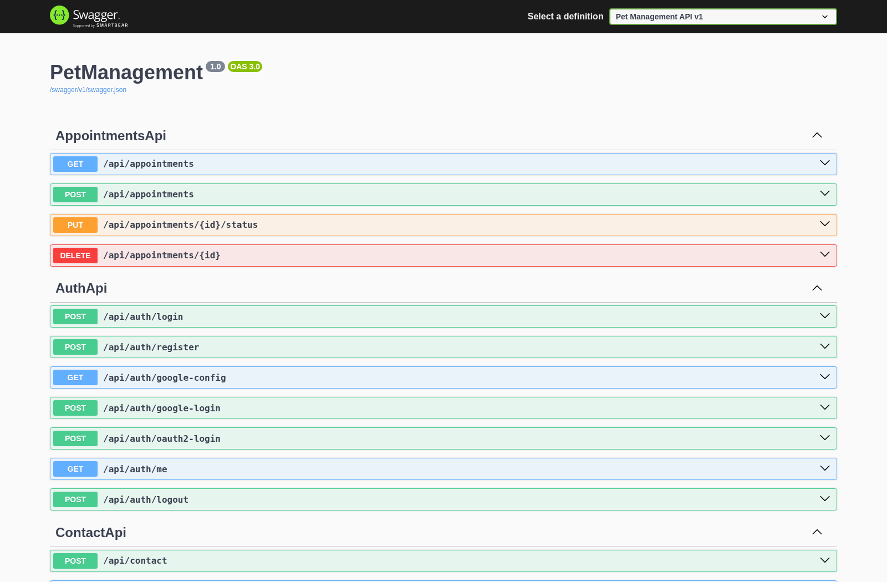
*Giao diện Swagger UI đặc tả đầy đủ các nhóm RESTful API tại http://localhost:5000/swagger*

> **Lời thuyết trình mẫu (Speaker Notes):**  
> "Đối với phân hệ Đặt lịch và Cửa hàng, hệ thống kiểm soát chặt chẽ nghiệp vụ: khách hàng chỉ đặt lịch cho thú cưng của mình, và khi thanh toán giỏ hàng, Backend kiểm tra tồn kho thực tế trước khi trừ số lượng và ghi nhận doanh thu lên Bảng quản trị Admin."

---

## Slide 08/15: KIẾN TRÚC CONTAINER HÓA & QUY HOẠCH 3 CỤM DOCKER COMPOSE
**Phân mục**: `CHƯƠNG 6: ĐÓNG GÓI DOCKER`  
*Vận hành đồng bộ 9 Containers trên mạng ảo bridge chung 'petnet' chỉ với một kịch bản khởi chạy*

### Nội dung chính trên Slide:
- Kỹ thuật Multi-stage Dockerfile: Tách biệt giai đoạn biên dịch (mcr.microsoft.com/dotnet/sdk:8.0) và giai đoạn chạy thực tế (mcr.microsoft.com/dotnet/aspnet:8.0), giảm hơn 65% dung lượng image.
- Cụm 1 - Ứng dụng (docker-compose.yml): Gồm petmanagement_webapp (cổng 5000:80) và petmanagement_sqlserver (SQL Server 2022 cổng 1433, lưu trữ bền vững trên volume sqlserver_data, có healthcheck sqlcmd).
- Cụm 2 - CI/CD (docker-compose.ci.yml): Gồm petmanagement_jenkins (cổng 8090:8080), petmanagement_sonarqube (cổng 9000) và petmanagement_sonar_db (PostgreSQL 15).
- Cụm 3 - Giám sát (docker-compose.monitoring.yml): Gồm petmanagement_prometheus (cổng 9091), petmanagement_grafana (cổng 3001), petmanagement_cadvisor (cổng 8082) và petmanagement_node_exporter (cổng 9101).

### Điểm nhấn (Key Metrics):
| **3 Cụm Compose**: App Cluster • CI/CD Cluster • Monitoring Cluster | **Mạng ảo petnet**: Kết nối nội bộ theo tên service chuẩn RFC | **1-Click Start**: Khởi chạy toàn bộ qua .\ci\scripts\start-cicd.ps1 |
| --- | --- | --- |

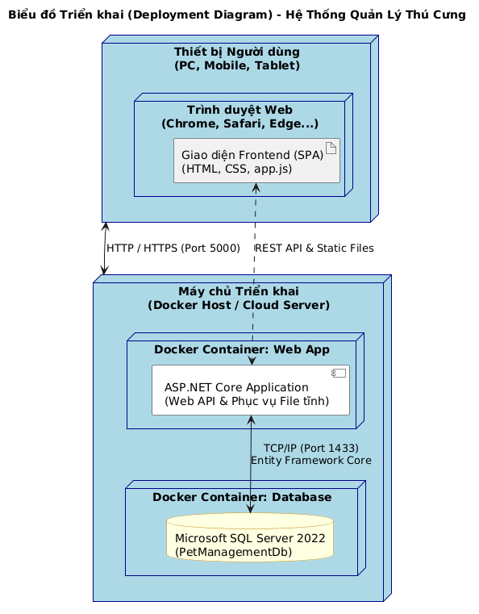
*Biểu đồ Triển khai (Deployment Diagram) giữa Trình duyệt, Web App Container và SQL Server 2022 Container*

> **Lời thuyết trình mẫu (Speaker Notes):**  
> "Bước sang phần triển khai DevOps, toàn bộ hệ thống gồm 9 containers được quy hoạch thành 3 file Docker Compose tách biệt theo chức năng nhưng kết nối chung trên mạng bridge petnet. Dữ liệu SQL Server 2022 được lưu trữ bền vững trên Docker Volume kèm cơ chế healthcheck tự động."

---

## Slide 09/15: XÂY DỰNG CUSTOM JENKINS IMAGE & CẤU HÌNH TỰ ĐỘNG
**Phân mục**: `CHƯƠNG 6: CÀI ĐẶT JENKINS`  
*Tích hợp sẵn .NET 8 SDK, SonarScanner, Docker CLI và OpenSSH Client bên trong container Jenkins*

### Nội dung chính trên Slide:
- Tùy biến Dockerfile riêng cho Jenkins (ci/jenkins/Dockerfile): Kế thừa từ jenkins/jenkins:lts-jdk17, cài đặt sẵn .NET 8.0 SDK, các thư viện hệ thống Debian (libicu, libssl3) và công cụ toàn cục dotnet-sonarscanner.
- Kỹ thuật Docker-outside-of-Docker (DooD): Cài đặt Docker CE CLI + Docker Compose Plugin và mount socket /var/run/docker.sock từ máy chủ Host, cho phép Jenkins trực tiếp đóng gói image và khởi chạy container.
- Cài đặt Plugin tự động (ci/jenkins/plugins.txt): Tự động nạp các plugin cốt lõi gồm git, workflow-aggregator, docker-workflow, sonar, ssh-agent, credentials-binding.
- Khởi tạo sẵn 2 Pipeline Jobs (init-jenkins.groovy): Tự động cấu hình kết nối SonarQube Server, Token xác thực và khởi tạo 2 luồng Pipeline: PetManagement-Local & PetManagement-Remote.

### Điểm nhấn (Key Metrics):
| **Custom Image**: Jenkins LTS + .NET 8 SDK + SonarScanner | **DooD Socket**: Điều khiển trực tiếp Docker Engine qua docker.sock | **2 Pipelines**: PetManagement-Local & PetManagement-Remote |
| --- | --- | --- |

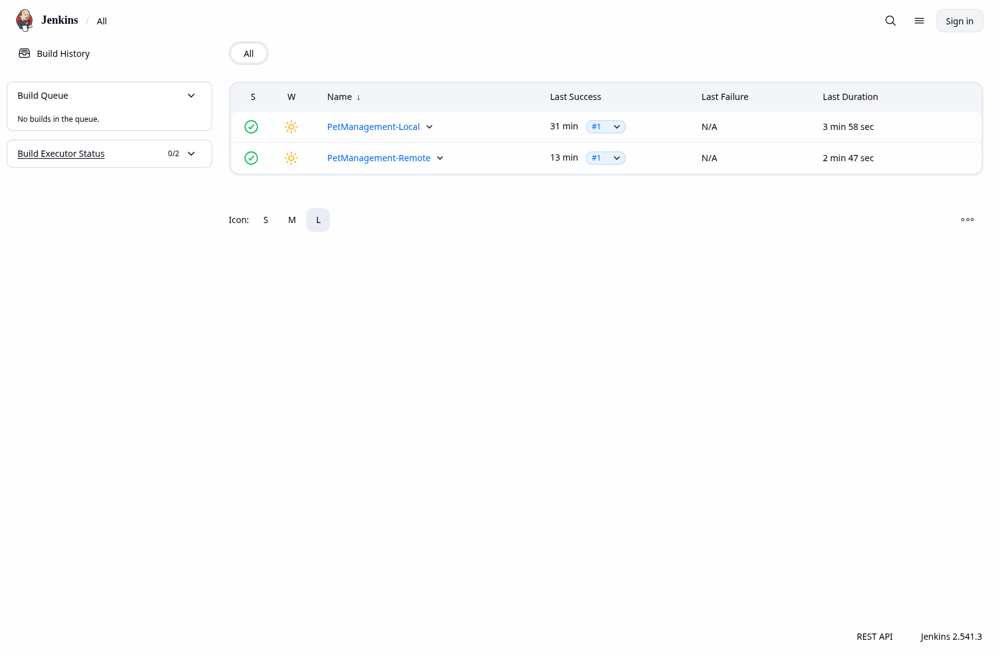
*Giao diện Jenkins Dashboard tại http://localhost:8090 với 2 Pipeline đều đạt trạng thái thành công*

> **Lời thuyết trình mẫu (Speaker Notes):**  
> "Để Jenkins có thể biên dịch code C# .NET 8, quét SonarQube và chạy lệnh Docker, nhóm đã xây dựng một Dockerfile tùy biến riêng cho Jenkins và áp dụng kỹ thuật Docker-outside-of-Docker thông qua việc chia sẻ socket /var/run/docker.sock."

---

## Slide 10/15: LUỒNG HOẠT ĐỘNG PIPELINE 8 STAGES & KIỂM CHỨNG THỰC TẾ
**Phân mục**: `CHƯƠNG 6: PIPELINE CI/CD (JENKINSFILE)`  
*Tự động hóa từ lúc kéo code GitHub, chạy Unit Test, kiểm định Quality Gate đến khi Deploy & Health Check*

### Nội dung chính trên Slide:
- Stage 1 (Checkout) & Stage 2 (Restore & Build): Kéo mã nguồn mới nhất từ GitHub, in mã Commit SHA và biên dịch dự án ở chế độ Release.
- Stage 3 (Unit Test) & Stage 4 (SonarQube Analysis): Chạy bộ kiểm thử xUnit xuất báo cáo độ phủ OpenCover XML, sau đó quét mã nguồn tĩnh và đẩy kết quả sang SonarQube.
- Stage 5 (Quality Gate - Chốt chặn chất lượng): Lệnh waitForQualityGate abortPipeline: true tự động dừng ngay pipeline nếu code không đạt chuẩn (như minh chứng thực tế ở Build #4 và Build #5).
- Stage 6 (Docker Build), Stage 7 (Deploy) & Stage 8 (Health Check): Khi vượt qua Quality Gate (như Build #6), Jenkins đóng gói image mới, chạy docker compose up -d và gọi /health xác nhận HTTP 200 OK.

### Điểm nhấn (Key Metrics):
| **8 Stages**: Tự động hóa 100% từ GitHub tới Production | **Auto-Abort**: Tự động chặn đứng bản build lỗi ở Stage 3 & Stage 5 | **Build #6 Green**: Hoàn tất toàn bộ 8/8 stages sau khi đạt chuẩn |
| --- | --- | --- |

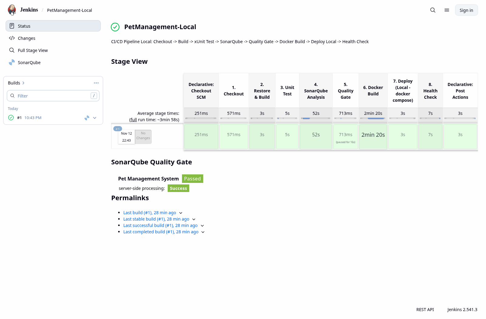
*Giao diện Stage View của Pipeline PetManagement-Local hiển thị đầy đủ 8 stages và trạng thái Quality Gate Passed*

> **Lời thuyết trình mẫu (Speaker Notes):**  
> "Đây là luồng hoạt động 8 bước trong Jenkinsfile. Trong quá trình phát triển, hệ thống đã chứng minh hiệu quả thực tế: khi code mới thiếu unit test hoặc có lỗi logic, Pipeline lập tức chặn lại ở Stage 3 hoặc Stage 5; chỉ khi toàn bộ test và SonarQube đạt chuẩn như ở bản Build mới nhất, Jenkins mới tiến hành đóng gói Docker và triển khai."

---

## Slide 11/15: PHÂN TÍCH MÃ NGUỒN TĨNH & KIỂM SOÁT SONARQUBE QUALITY GATE
**Phân mục**: `CHƯƠNG 6: TÍCH HỢP SONARQUBE`  
*Tích hợp hai chiều giữa Jenkins và SonarQube qua Token xác thực & Webhook tự động*

### Nội dung chính trên Slide:
- Cơ chế giao tiếp nội bộ chuẩn RFC: Jenkins đẩy dữ liệu phân tích tới http://sonarqube:9000 kèm báo cáo độ phủ tests/PetManagement.Tests/coverage.opencover.xml; SonarQube trả kết quả về http://jenkins:8080/sonarqube-webhook/.
- Độ phủ kiểm thử tự động vượt trội (Code Coverage): Bộ kiểm thử xUnit bao phủ toàn bộ 7 API Controllers giúp độ phủ tổng thể đạt 91.2% (độ phủ trên code mới đạt 91.7%, vượt xa ngưỡng yêu cầu 80%).
- Đạt xếp hạng A tuyệt đối trên cả 4 trụ cột: Security Rating A (0 Vulnerabilities), Reliability Rating A (0 Bugs), Maintainability Rating A (0 Code Smells), Security Review Rating A (100%).
- Tỷ lệ trùng lặp mã nguồn (Duplications): Đạt mức tối ưu 0.0% (< 3%), trạng thái Quality Gate chính thức đạt PASSED.

### Điểm nhấn (Key Metrics):
| **Quality Gate**: PASSED (100% đạt chuẩn kiểm định) | **91.2% Coverage**: Vượt ngưỡng 80% của chuẩn Clean as You Code | **4 Hạng A**: 0 Bugs • 0 Vulnerabilities • 0.0% Duplications |
| --- | --- | --- |

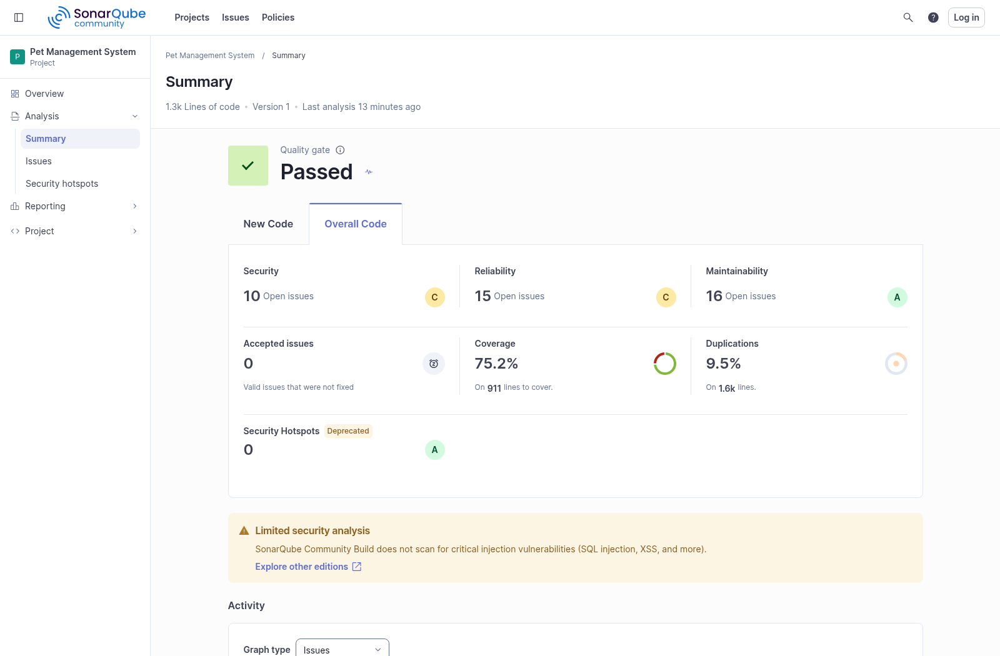
*Kết quả phân tích chất lượng mã nguồn trên SonarQube Dashboard tại http://localhost:9000*

> **Lời thuyết trình mẫu (Speaker Notes):**  
> "Slide 11 trình bày kết quả tích hợp SonarQube vào Jenkins. Nhờ giao tiếp hai chiều qua Webhook và bộ kiểm thử xUnit + Coverlet, dự án đạt trạng thái Quality Gate: PASSED với độ phủ mã nguồn lên tới 91.2%, 0 lỗi bảo mật, 0 bug và đạt hạng A trên tất cả các chỉ số."

---

## Slide 12/15: TỰ ĐỘNG DEPLOY LÊN SERVER PUBLIC QUA SSH (JENKINSFILE.REMOTE)
**Phân mục**: `CHƯƠNG 6: TRIỂN KHAI TỪ XA QUA SSH`  
*Cấu hình Pipeline thứ hai triển khai trực tiếp ứng dụng lên máy chủ từ xa và kiểm tra qua địa chỉ Public*

### Nội dung chính trên Slide:
- Thiết kế Pipeline PetManagement-Remote (Jenkinsfile.remote): Giữ nguyên 6 stage kiểm thử và phân tích SonarQube đầu tiên, nâng cấp Stage 7 và Stage 8 để triển khai qua giao thức SSH.
- Tham số hóa máy chủ đích (Build with Parameters): Cho phép nhập linh hoạt SERVER_HOST (IP hoặc Domain public của VPS/Cloud Server), SERVER_USER (tài khoản SSH), DEPLOY_DIR (/opt/petmanagement).
- Quy trình 4 bước tự động qua SSH Private Key (prod-server-ssh): (1) Tạo thư mục từ xa qua ssh mkdir -p; (2) Sao chép docker-compose.yml lên server qua scp; (3) Truyền trực tiếp Docker Image qua đường ống nén docker save | gzip | ssh 'gunzip | docker load'; (4) Thực thi từ xa lệnh docker compose up -d.
- Xác nhận hoạt động qua IP Public (Stage 8 - Public Health Check): Jenkins tự động truy vấn http://${SERVER_HOST}:5000/health để đảm bảo phần mềm truy cập thành công từ Internet.

### Điểm nhấn (Key Metrics):
| **SSH + SCP**: Bảo mật bằng khóa bất đối xứng Private Key | **Direct Stream**: Truyền thẳng image qua docker save | ssh docker load | **Public Verify**: Tự động kiểm tra http://PUBLIC_IP:5000/health |
| --- | --- | --- |

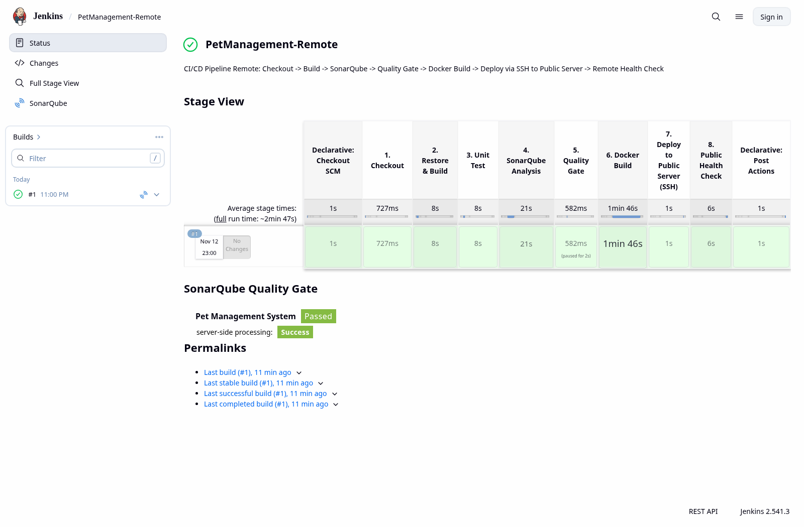
*Kết quả thực thi Pipeline PetManagement-Remote hoàn tất triển khai tự động qua SSH*

> **Lời thuyết trình mẫu (Speaker Notes):**  
> "Đáp ứng yêu cầu tự động deploy lên server public qua SSH, nhóm đã xây dựng pipeline thứ hai trong file Jenkinsfile.remote. Điểm đặc biệt là quy trình sử dụng đường ống nén docker save kết hợp ssh docker load để truyền trực tiếp image vừa build sang máy chủ đích, khởi chạy docker compose và kiểm tra trực tiếp địa chỉ public của server."

---

## Slide 13/15: GIÁM SÁT HỆ THỐNG ĐA TẦNG VỚI PROMETHEUS (4/4 TARGETS UP)
**Phân mục**: `CHƯƠNG 7: GIÁM SÁT PROMETHEUS`  
*Thu thập chỉ số vận hành thời gian thực từ Ứng dụng .NET 8, Docker Containers và Máy chủ Host*

### Nội dung chính trên Slide:
- 1. Tầng Ứng dụng (petmanagement_webapp): Tích hợp thư viện prometheus-net.AspNetCore trong Program.cs (app.UseHttpMetrics() và app.MapMetrics()), xuất dữ liệu chuẩn OpenMetrics tại http://localhost:5000/metrics.
- 2. Tầng Container (petmanagement_cadvisor - cổng 8082): Sử dụng Google cAdvisor đo lường mức sử dụng CPU, bộ nhớ RAM, băng thông mạng và I/O ổ đĩa của từng container trong thời gian thực.
- 3. Tầng Máy chủ (petmanagement_node_exporter - cổng 9101): Thu thập thông số tài nguyên phần cứng và hệ điều hành của máy chủ Host.
- 4. Máy chủ Prometheus (http://localhost:9091/targets): Cấu hình scrape_interval 10s-15s trong monitoring/prometheus/prometheus.yml; toàn bộ 4/4 Targets đều hoạt động ổn định ở trạng thái UP.

### Điểm nhấn (Key Metrics):
| **4/4 Targets UP**: webapp • cadvisor • node_exporter • prometheus | **10s Interval**: Chu kỳ thu thập metrics ứng dụng thời gian thực | **/metrics & /health**: Tích hợp trực tiếp trong ASP.NET Core 8.0 |
| --- | --- | --- |

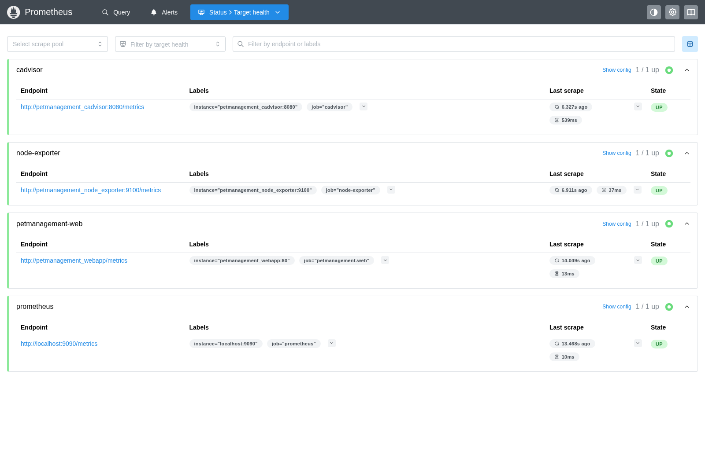
*Giao diện Prometheus Status -> Targets tại http://localhost:9091/targets xác nhận cả 4/4 điểm thu thập đều UP*

> **Lời thuyết trình mẫu (Speaker Notes):**  
> "Sau khi ứng dụng được triển khai, hệ thống giám sát Prometheus sẽ liên tục thu thập thông số ở cả 3 tầng: tầng ứng dụng .NET 8 thông qua endpoint /metrics, tầng container qua cAdvisor và tầng máy chủ qua Node Exporter. Trên giao diện Prometheus Targets, cả 4 trên 4 mục tiêu đều đạt trạng thái UP màu xanh."

---

## Slide 14/15: BẢNG ĐIỀU KHIỂN GRAFANA AUTO-PROVISIONING (8 BIỂU ĐỒ)
**Phân mục**: `CHƯƠNG 7: TRỰC QUAN HÓA GRAFANA`  
*Tự động nạp sẵn Datasource và Dashboard giám sát toàn diện tại http://localhost:3001*

### Nội dung chính trên Slide:
- Cơ chế Auto-Provisioning (monitoring/grafana/provisioning/): Tự động kết nối nguồn dữ liệu Prometheus (http://prometheus:9090) và nạp sẵn Dashboard ngay khi container Grafana khởi động.
- 4 Biểu đồ Trạng thái nhanh (Stat Panels): (1) Trạng thái Ứng dụng PetManagement (UP); (2) Tổng số HTTP Requests đã xử lý; (3) Tổng số Containers đang hoạt động; (4) Dung lượng RAM tiêu thụ của tiến trình .NET 8.
- 4 Biểu đồ Chuỗi thời gian (Time-Series Panels): (5) Lưu lượng HTTP Requests/giây phân loại theo mã trạng thái (2xx, 4xx, 5xx); (6) Độ trễ phản hồi phân vị thứ 95 (P95 Latency); (7) Mức tải CPU theo thời gian thực; (8) Lưu lượng mạng Nhận/Gửi (Network I/O).
- Giá trị vận hành: Giúp đội ngũ quản trị phát hiện tức thì các điểm nghẽn hiệu năng, các API có độ trễ cao hoặc sự cố tăng đột biến lỗi HTTP 5xx.

### Điểm nhấn (Key Metrics):
| **8 Panels**: 4 Stat Panels + 4 Time-Series Charts | **Auto-Provisioned**: Tự động nạp cấu hình JSON không cần cài tay | **Real-time P95**: Theo dõi độ trễ API, lưu lượng HTTP, CPU & RAM |
| --- | --- | --- |

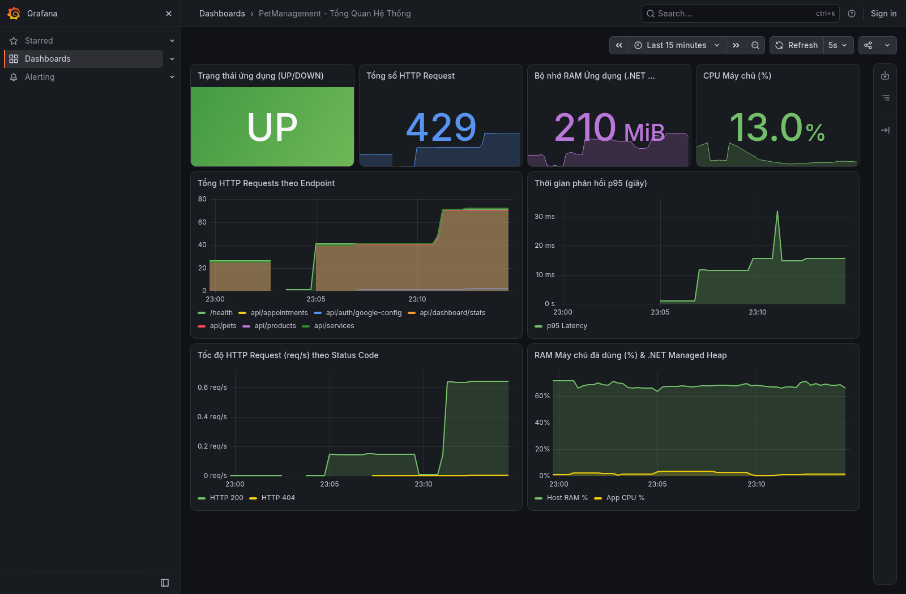
*Giao diện Grafana Dashboard tại http://localhost:3001 hiển thị trực quan 8 biểu đồ giám sát hệ thống*

> **Lời thuyết trình mẫu (Speaker Notes):**  
> "Từ dữ liệu của Prometheus, Grafana được cấu hình Auto-Provisioning để tự động hiển thị bảng điều khiển gồm 8 biểu đồ trực quan tại cổng 3001. Quản trị viên có thể theo dõi theo thời gian thực trạng thái sống của dịch vụ, tốc độ request trên giây, độ trễ P95 cũng như mức tiêu thụ CPU, RAM và băng thông mạng."

---

## Slide 15/15: TỔNG KẾT KẾT QUẢ ĐẠT ĐƯỢC & ĐỊNH HƯỚNG PHÁT TRIỂN
**Phân mục**: `CHƯƠNG 8: TỔNG KẾT & HƯỚNG PHÁT TRIỂN`  
*Hoàn thành trọn vẹn hệ thống phần mềm Quản lý Thú cưng gắn liền với quy trình DevOps CI/CD hiện đại*

### Nội dung chính trên Slide:
- Kết quả phần mềm: Hoàn thiện ứng dụng Web PetCare Hub (.NET 8 + SQL Server 2022 + SPA) với 7 bảng dữ liệu chuẩn hóa, xác thực Google OAuth2 có đồng bộ phiên, xóa thú cưng linh hoạt và thanh toán kiểm soát tồn kho thực tế.
- Kết quả CI/CD & Đảm bảo chất lượng: Vận hành ổn định 2 Pipeline trên Jenkins (Local & Remote SSH), tích hợp bộ kiểm thử xUnit đạt độ phủ 91.2% và vượt qua SonarQube Quality Gate với xếp hạng A tuyệt đối.
- Kết quả Đóng gói & Giám sát: Quy hoạch chuẩn 9 Docker Containers trên 3 cụm Compose; giám sát 24/7 với Prometheus (4/4 Targets UP) và Grafana Dashboard 8 biểu đồ.
- Hướng phát triển tương lai: (1) Tích hợp cổng thanh toán trực tuyến VNPay/VietQR tự động đối soát Webhook; (2) Tích hợp SignalR & gửi Email nhắc lịch tiêm phòng tự động; (3) Mở rộng cảnh báo Prometheus Alertmanager qua Telegram/Slack và triển khai trên cụm Kubernetes (K8s).

### Điểm nhấn (Key Metrics):
| **100% Hoàn thành**: Đáp ứng đầy đủ mọi yêu cầu Nghiệp vụ & CI/CD | **Sẵn sàng Mở rộng**: Hướng tới tích hợp VietQR, SignalR & Kubernetes | **Cảm ơn Thầy/Cô!**: Nhóm sẵn sàng thực hiện Demo trực tiếp & Vấn đáp |
| --- | --- | --- |

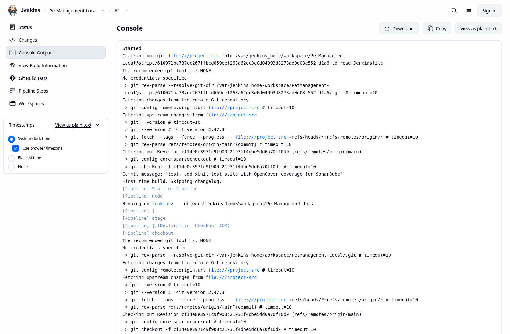
*Nhật ký Console Output xác nhận toàn bộ quy trình CI/CD thực thi thành công*

> **Lời thuyết trình mẫu (Speaker Notes):**  
> "Tổng kết lại, dự án đã hoàn thành toàn diện cả về mặt nghiệp vụ phần mềm lẫn hạ tầng tự động hóa CI/CD và giám sát hệ thống. Toàn bộ mã nguồn, báo cáo tổng kết và kịch bản CI/CD đều đã được đồng bộ đầy đủ trên GitHub. Em xin cảm ơn thầy/cô đã lắng nghe và xin phép chuyển sang phần Demo trực tiếp trên hệ thống!"

---
